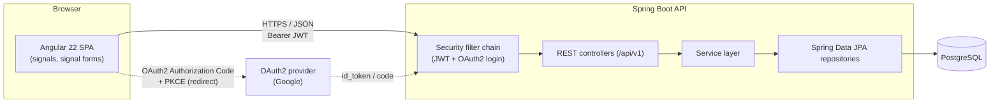
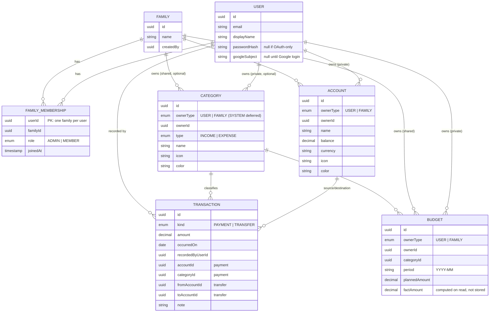
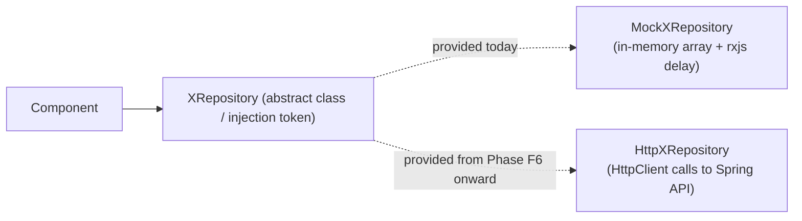
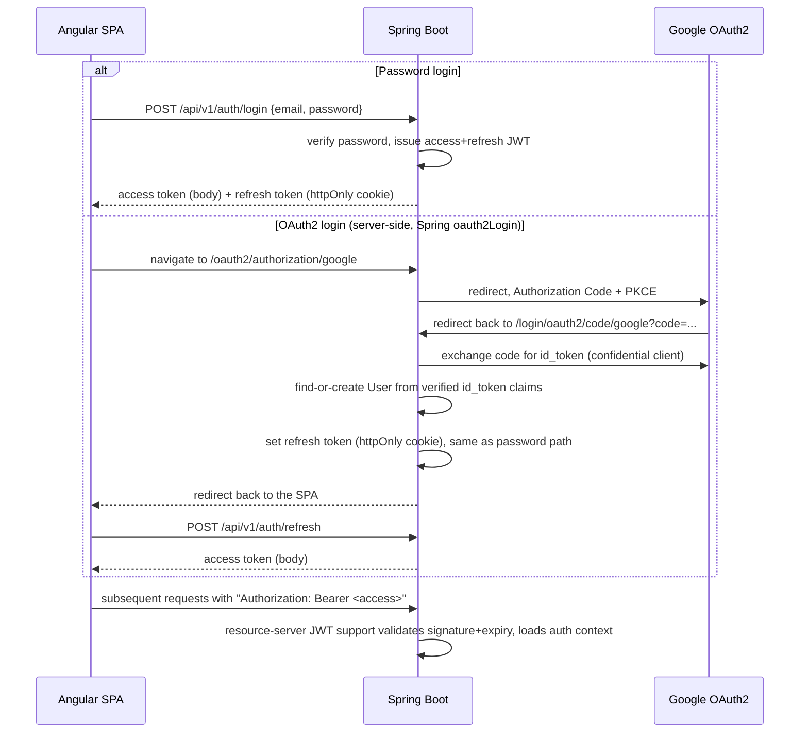

# Family Budget — Architecture

Status: draft v0.6 · 2026-10-06
Companion doc: [PLAN.md](./PLAN.md) (roadmap, phases, open decisions)

## 1. Purpose

Family Budget lets a household track money together while each member keeps some of it
private. A user can:

- manage **private** accounts, categories, transactions and budgets visible only to them,
- manage **shared** (family-wide) accounts, categories, transactions and budgets visible to
  every member of their family,
- belong to exactly one family at a time (v1 simplification, see §7).

This document describes the target system shape. It is intentionally stack-accurate but
implementation-light — concrete code arrives phase by phase per [PLAN.md](./PLAN.md).

## 2. High-level system



- **Frontend** is a single Angular SPA. No server-side rendering requirement for v1.
- **Backend** is a single Spring Boot modular-monolith (not microservices — scope doesn't
  justify the operational cost yet; see §8 for the tradeoff).
- **Auth** has two entry points that both resolve to the same backend-issued JWT session:
  password login (JWT) and OAuth2/OIDC login (Google first). See §6.
- **Database** is one PostgreSQL instance; one schema, Flyway-versioned.

## 3. Domain model

### 3.1 Entities



### 3.2 Ownership / sharing rule

Every shareable aggregate (`Account`, `Category`, `Budget`) carries `ownerType` +
`ownerId` instead of a boolean "shared" flag:

- `ownerType = USER, ownerId = <userId>` → private, visible only to that user.
- `ownerType = FAMILY, ownerId = <familyId>` → shared, visible to every member of that
  family.

This single polymorphic-owner pattern avoids duplicating each table into
`*_private` / `*_shared` variants and keeps authorization logic in one place
(see §6.3). `Transaction` has no owner of its own — its visibility is derived from the
account(s) it touches:

- **Visible** to anyone who can see *at least one* of its accounts, and reported as
  `shared` if any of them is shared. A family member therefore sees Alice's transfer from
  her private card into the family account, with the card shown as a reference (name,
  currency, icon, color — never its balance).
- **Deletable** only by someone who can access *all* of its accounts; otherwise
  `403 transaction-not-editable`. Transactions are immutable — correcting one means
  deleting and re-creating it. Recording or deleting a transaction adjusts the touched
  balances in the same database transaction (atomic `balance = balance + delta`).
- A payment's direction comes from its category type (income adds, expense subtracts);
  amounts are always positive. Transfers require both accounts to share a currency.

Other ownership rules:

- An aggregate's visibility (private/shared) is fixed at creation
  (`409 visibility-immutable`), since flipping it would silently change who sees its
  history. A category's income/expense type is fixed too, because it determines what past
  payments did to balances.
- Creating something `shared` without a family fails with `409 no-family`.
- Accounts and categories that are still referenced (transactions, budgets) can't be
  deleted (`409 account-in-use` / `category-in-use`), enforced by foreign keys.
- `owner_id` has no foreign key (it points at users *or* families). Deleting a family
  (its last member leaving) currently leaves its shared data orphaned — to be fixed with a
  `FamilyDeleted` application event (Spring Modulith's event registry is already set up).
- `SYSTEM`-owned default categories are deferred: the frontend's `Visibility` type has no
  value to show them with.

**Budgets** are monthly, one per owner/category/month. `factAmount` is the sum of the
category's payments in that month, computed on every read (indexed on
`(category_id, occurred_on)`): a **private** budget counts only its owner's own payments,
a **shared** budget counts every member's. A shared budget must use a shared category, so
every member can see what it tracks.

A user belongs to at most one family in v1. There is no `activeFamilyId` column on the
user: `family_members` is keyed by `user_id`, so the membership row *is* the user's
current family (one source of truth, nothing to keep in sync). Other modules ask
`FamilyService.currentFamilyId(userId)`. Creating/joining a family is a deliberate
action via a single-use invite code (8 chars, 7-day expiry) that an admin shares out of
band — no email delivery in v1. Users who don't belong to a family only ever see private
data. Multi-family-per-user is listed as a v2 idea, not built now (§7); it would bring
back an explicit active-family choice.

### 3.3 Relationship to current frontend types

The API follows the frontend's `model/types.ts` (as of M8) rather than the database
shape: `visibility: 'private' | 'shared'` instead of `ownerType`/`ownerId`, and
lower-case enum values (`'income'`, `'payment'`, `'admin'`, …). Differences the M9
integration absorbed — the frontend types now use string ids and an `IAccountRef` for
transaction accounts, and the `Http*Repository` classes do the remaining mapping, so the
repository contracts stayed as they were:

- Ids are UUID strings, not `number`.
- Transaction `date` is an ISO `YYYY-MM-DD` string; transactions also carry `kind`
  (`'payment' | 'transfer'`), `note` and `recordedBy`. Their accounts are `AccountRef`s
  (no `balance`), and the unused pair (`account`/`category` vs. `fromAccount`/`toAccount`)
  is omitted from the JSON, so the frontend's `isTransferTransaction` check still works.
- Creating a transaction sends ids (`accountId` + `categoryId`, or `fromAccountId` +
  `toAccountId`) plus `kind`, not embedded objects.
- Creating/updating a budget sends `categoryId`, not an embedded category.
- `GET /transactions` returns a page wrapper (§5.3), not a bare array.
- The current user (`GET /users/me`) has no `familyId`; the family comes from
  `GET /families/current` (404 when there is none).

## 4. Frontend architecture (Angular)

### 4.1 Stack

- Angular 22, standalone components only (no NgModules).
- **Signals** for all local/component state; `signal()`, `computed()`, `effect()`,
  `linkedSignal()` where appropriate.
- **Signal Forms** (`@angular/forms/signals`) replacing the current `ReactiveFormsModule`
  usage in `account-form.ts` once the project is on v22 — tracked as its own phase so the
  migration doesn't get entangled with new features.
- `rxResource` (already in use in `account-list.ts`) for request-backed state; plain
  `resource()` where a request is driven by a signal instead of an `Observable`.
- No NgRx / global store library. Domain state lives in per-domain **signal-based
  services** (`providedIn: 'root'`), each exposing readonly signals + methods — the same
  shape a lightweight SignalStore would have, without the extra dependency. Revisit only
  if cross-feature state coordination actually gets painful.

### 4.2 Folder structure (target)

```
src/app/
  core/                     # app-wide singletons, no UI
    auth/                   # auth state service, login/refresh flows, route guards
    http/                   # interceptors (auth header, error mapping, retry)
    config/                 # environment/config access
  shared/                   # dumb, reusable, no domain knowledge
    ui/                     # buttons, icon-picker, color-picker, modal, form controls
    pipes/ directives/
  model/                    # shared TypeScript interfaces/types (today: types.ts)
  features/
    accounts/
      data/                 # AccountRepository interface + mock & http implementations
      account-list/ account-form/ ...
    categories/
    transactions/
    budgets/
    family/                 # family creation, invites, member list, role management
    dashboard/              # aggregated overview (balances, month summary)
  app.routes.ts             # lazy-loaded per feature
```

Today's `services/account-service.ts` and `components/account-list|account-form/*` map
onto `features/accounts/*` — a rename/move, not a rewrite, happens when that feature
area is revisited (see PLAN M2/M6).

### 4.3 Mock-first data layer (the "dumb hardcoded service" strategy)

Goal: build and visually/behaviorally validate every screen before the backend exists,
then swap in real HTTP without touching components.



- Each domain defines a repository **contract** (abstract class, so it's a valid DI
  token) returning `Observable<T>` — matching today's `AccountService` method shapes
  (`getAccounts/create/update/delete`) so the contract barely has to change.
- Two implementations: `Mock*Repository` (current style: in-memory arrays + `delay()` to
  simulate latency, including simulated validation errors) and, later, `Http*Repository`.
- Components/pages inject the **abstract contract**, never a concrete implementation —
  swapping is a one-line change in `app.config.ts` providers (or per-environment
  provider), not a component rewrite. This is the one structural rule worth adopting now,
  before more features are built on top of today's concrete `AccountService`.
- Mock data should intentionally include edge cases (zero balances, multiple currencies,
  a shared + a private account, an over-budget category) so UI states aren't discovered
  late.

As of M9 the mocks are deleted: every contract has only its `Http*Repository`
implementation, mapping DTOs (UUID ids, ISO date strings, ids instead of embedded
objects on create) and turning backend `ProblemDetail` types into user-facing messages
(`core/http/problem.ts`).

### 4.4 Auth on the frontend

- `core/auth/AuthState` holds the current user and the access token in signals —
  memory only, never localStorage (§6.2). The user's `familyId` is looked up via
  `GET /families/current` right after a session starts.
- `provideAppInitializer` calls `restoreSession()` before the first route guard runs:
  a `POST /auth/refresh` with the httpOnly cookie, so a reload keeps the user logged in.
- `authInterceptor` adds the bearer token to `/api` calls (not `/api/v1/auth/*`). On a
  401 it refreshes once — concurrent 401s share one refresh, since each refresh rotates
  the cookie — and retries; if refreshing fails it clears the session and goes to
  `/login`.
- Google login is a full-page navigation to `/oauth2/authorization/google`. The backend
  redirects back to `/auth/callback`; by then the startup refresh has already restored
  the session, so `oauthCallbackGuard` just routes to `/dashboard` (or to
  `/login?error=oauth` on failure).
- Route guards (`authGuard`, `guestGuard`) are functional `canActivate` guards on the
  auth signal.
- Local dev: `ng serve` proxies `/api`, `/oauth2` and `/login/oauth2` to the backend
  (`src/proxy.conf.json`), so the browser sees one origin — no CORS, and the refresh
  cookie (`Path=/api/v1/auth`, `SameSite=Strict`) behaves as in production.

## 5. Backend architecture (Spring Boot)

### 5.1 Stack

- Spring Boot 4.1.x (Spring Framework 7, Spring Security 7, Hibernate 7 / JPA 3.2,
  Jakarta EE 11), Java 25 (LTS). Maven.
- Spring Web MVC (REST), Spring Security (OAuth2 Resource Server for JWT validation,
  OAuth2 Client for Google login), Spring Data JPA, Flyway, Bean Validation, Actuator.
- Spring Modulith 2.x to verify module boundaries in tests (§5.2).
- PostgreSQL 18 (Docker Compose for local dev, auto-started via
  `spring-boot-docker-compose`).
- Entity↔DTO mapping is hand-written (`toView()` methods / small records) while mappings
  stay trivial; MapStruct was considered but skipped in M7 — revisit if M8's DTOs grow
  enough to make it pay off.
- Jackson 3 (`tools.jackson.*`) is Boot 4's default; any custom (de)serializers target it.
- JSpecify `@Nullable`/`@NonNull` for null-safety in our own code, matching Spring 7.
- Testing: JUnit 5 + Testcontainers 2.x (real Postgres in integration tests, not H2).
- Boot 4 split auto-configuration into finer-grained modules: each technology needs its
  own starter (e.g. `spring-boot-starter-flyway`, not just `flyway-core`), and several
  classes moved packages (e.g. `EndpointRequest` →
  `org.springframework.boot.security.autoconfigure.actuate.web.servlet`) — older Boot 3
  examples won't compile as-is.

### 5.2 Module / package layout

Package-by-feature, not package-by-layer, to keep each domain's controller/service/repo/
entity/dto together:

```
com.familybudget
  common/            # ProblemDetail error handling, pagination, auditing base entity
  security/          # JWT filter, OAuth2 success handler, JWT issuing/validation, roles
  user/              # User entity, registration, profile
  family/            # Family, FamilyMembership, invites
  account/
  category/
  transaction/
  budget/
```

Each feature package is flat: `*Controller`, `*Service`, `*Repository`, `*Entity` and
request/response records. Only the `*Service` and its view records are `public` (the
module's API); repositories and entities are package-private, so Java visibility and
Spring Modulith both stop other modules reaching them. Cross-feature calls go through the
other feature's `*Service`, never its repository — keeps future extraction into separate
services possible without a rewrite.

`security` depends on `user` (to verify passwords and find-or-create Google users), never
the other way round. Controllers in any module get the caller's id via `common`'s
`@CurrentUserId UUID` parameter (the JWT `sub`), so feature modules never depend on
`security`.

Each top-level package is a Spring Modulith application module. `ModularityTests` runs
`ApplicationModules.verify()` so a module reaching into another's internals (e.g. its
repository or entity) fails the build instead of relying on review discipline. `common`
is declared an *open* module since every feature uses it.

### 5.3 API conventions

- Base path `/api/v1`, resource-oriented REST. Full-object updates use `PUT` (the
  frontend's repositories send whole objects); `PATCH` is used only for genuinely partial
  changes (a family member's role).
  Decided in M7: `/api/v1` is written directly into each `@RequestMapping`. Spring
  Framework 7's API versioning would need a `{version}` segment in every mapping anyway and
  buys nothing until a `v2` exists; the URL shape is the same either way.
- All list endpoints return only what the caller is authorized to see (own private data
  ∪ their active family's shared data) — enforced in the service layer, not trusted from
  query params.
- Errors as RFC 9457 `ProblemDetail` with a stable `type` URI the frontend can switch on
  (not just an HTTP status), e.g. `https://familybudget.app/problems/email-taken`.
- Pagination via `page`/`size` query params (size 1–200, default 50) on transaction
  lists, returning `{content, page, size, totalElements, totalPages}` — our own
  `PageView` record, not Spring Data's `Page` JSON. Other lists are small and unpaged.
- Money is JSON numbers with two decimals (`NUMERIC(19,2)` in the database).

### 5.4 Error handling

A single `@RestControllerAdvice` in `common` translates domain exceptions into consistent
`ProblemDetail` responses. Domain errors are `ApiException(status, type, message)` (with
`NotFoundException` as a shorthand); the `type` slug becomes the problem `type` URI.
Bean Validation failures are handled by Spring MVC's built-in `ProblemDetail` support.
Frontend's HTTP error interceptor (§4.4) depends on this shape being stable from day one.

Problem types so far: `not-found`, `email-taken`, `invalid-credentials`,
`invalid-refresh-token`, `email-not-verified`, `unauthenticated`, `already-in-family`,
`invalid-invite`, `admin-required`, `last-admin`, `cannot-remove-self`, `no-family`,
`visibility-immutable`, `category-type-immutable`, `account-in-use`, `category-in-use`,
`invalid-transaction`, `currency-mismatch`, `transaction-not-editable`,
`category-not-shared`, `budget-exists`.

401/403 raised by the security filters themselves (missing/invalid access token) get the
same shape (`unauthenticated` / `forbidden`) via custom entry point and access-denied
handlers, alongside the standard `WWW-Authenticate: Bearer …` header.

## 6. Security design

### 6.1 Two login paths, one session model



Both paths converge on the same backend-issued JWT — the rest of the API never has to
know whether a session started via password or Google. This is the key simplification:
OAuth2 is a *login method*, not a parallel authorization system.

The Google flow runs entirely on the backend (Spring's `oauth2Login`, backend as a
confidential client): the SPA never sees the authorization code or Google's tokens. After
login the backend only sets the refresh cookie and redirects to the SPA, which then
obtains its access token through the normal `/auth/refresh` call — so the access token
never travels in a URL.

No hand-written JWT filter: tokens are issued with Spring Security's `NimbusJwtEncoder`
and validated by its OAuth2 Resource Server support (`NimbusJwtDecoder`), signed with an
HMAC key from configuration (`JWT_SECRET`). Switching to an asymmetric key pair later
only changes those two beans.

### 6.2 Token handling

- Short-lived **access token** (HS256 JWT, 15 min, `sub` = user id, plus `email`),
  returned in the response body, held in frontend memory only (never localStorage, to
  limit XSS blast radius).
- Longer-lived **refresh token** (30 days): an opaque random value, not a JWT, stored
  server-side only as a SHA-256 hash in `refresh_tokens`. Sent as an httpOnly + Secure +
  SameSite=Strict cookie scoped to `Path=/api/v1/auth`, so it only reaches the auth
  endpoints. Rotated on every `/auth/refresh`.
- **Reuse detection**: presenting an already-rotated token is rejected. If it was rotated
  more than 30 s ago (`reuse-grace`) it's treated as stolen and *all* of that user's
  refresh tokens are revoked; within the grace window (e.g. two tabs refreshing at once)
  it's just rejected, so the other tab's fresh token keeps working.
- **Logout** revokes the presented refresh token in the database and clears the cookie.
  Access tokens aren't denylisted — they simply expire within 15 min.
- The auth endpoints ignore any `Authorization` header, so the SPA can call
  `/auth/refresh` with an expired access token still attached.
- A daily job (`RefreshTokenCleanup`, cron `app.security.refresh-token.cleanup-cron`)
  deletes tokens past their expiry. Revoked-but-unexpired rows are kept deliberately:
  replaying one is what triggers reuse detection.

### 6.3 Authorization (private vs. shared data)

- Every request carries the authenticated `userId` (from JWT) resolved server-side to
  their current family via `FamilyService.currentFamilyId(userId)` (§3.2).
- Repository queries for `Account`/`Category`/`Budget`/`Transaction` are always scoped to
  `ownerType=USER AND ownerId=:userId OR ownerType=FAMILY AND ownerId=:activeFamilyId` —
  centralized in the service layer (§5.2) so no controller can accidentally leak
  cross-family data.
- Mutating a `FAMILY`-owned resource additionally checks the caller is a member (any
  role) of that family; family-management actions (invite, remove member, change role)
  require `ADMIN`.
- A family always keeps at least one `ADMIN`: the last admin can't leave or be demoted
  while other members remain. The last member leaving deletes the family.

### 6.4 Transport/infra

- HTTPS in any deployed environment. Local dev runs on plain `http://localhost`: browsers
  treat localhost as a secure context, so the `Secure` refresh cookie still works there
  (`REFRESH_COOKIE_SECURE=false` is the escape hatch). mkcert was the original idea and
  turned out unnecessary.
- CORS restricted to the known frontend origin(s) per environment; unused in local dev,
  where `ng serve` proxies the API so everything is same-origin.
- Packaging: multi-stage `Dockerfile` (JDK build → layered JRE runtime, non-root user).
  `compose.yaml` runs Postgres for `spring-boot:run`, plus the backend itself behind the
  opt-in `app` profile. Deployment target is still open (PLAN.md open decision #4).
- CI: GitHub Actions in each repo — backend `./mvnw verify` (Testcontainers on the
  runner's Docker) and an image build; frontend build + unit tests.

## 7. Explicit v1 simplifications (revisit later, not now)

- One active family per user (no multi-family switching).
- Single currency assumed per account; no cross-currency conversion/FX.
- Budgets are monthly (`period = YYYY-MM`); no custom date ranges yet.
- No recurring-transaction scheduler.
- `Budget.factAmount` is computed on read (one aggregate query per budget) instead of
  cached — always correct, cheap at v1 volumes; cache it only if budget lists get slow.
- Transactions are create/delete only; no in-place edits.

## 8. Key decisions & why

| Decision | Choice | Why |
|---|---|---|
| Repos | Two repos (`budget-app-front` existing, new `budget-app-backend`) | Different stacks/lifecycles/CI; a monorepo buys nothing here since there's no shared build tooling between Angular and Spring Boot. Keep this doc + PLAN.md in the frontend repo for now (it exists today); mirror or move to the backend repo once that exists — whichever the user prefers at that point. |
| Backend topology | Modular monolith | Family Budget's scope (a handful of bounded contexts, one team) doesn't justify microservice operational cost. Package-by-feature keeps a future split possible. |
| Frontend state | Per-domain signal services, no NgRx | Matches Angular's current direction (signals as the primitive); avoids a global-store dependency the app's complexity doesn't need yet. |
| Mock-to-real swap | Abstract repository contract + DI token/provider swap | Lets UI work start immediately (per user's request) without a later rewrite; only the provider wiring changes. |
| Sharing model | Polymorphic `ownerType/ownerId` on Account/Category/Budget | One mental model and one authorization check path instead of duplicated private/shared tables or scattered boolean flags. |
| Auth | JWT access token (body) + refresh token (httpOnly cookie); OAuth2 as alternate login only | Standard, well-understood SPA pattern; OAuth2 complexity isolated to the login step instead of leaking into every authorization decision. |
| Backend version | Spring Boot 4.1 / Java 25 | The whole 3.x line left OSS support on 2026-06-30 (3.5 was the last); starting a new project on it would mean starting unsupported. Java 25 is the current LTS. |
| JWT handling | Spring Security resource server + `NimbusJwtEncoder`, not a custom filter | Less security code of our own to get wrong; key rotation/asymmetric keys become a bean swap. |
| Module boundaries | Spring Modulith verification in tests | Turns the "only call another feature's service" rule (§5.2) into a failing build instead of a convention. |

## 9. Open questions

Tracked with owners/status in [PLAN.md §Open decisions](./PLAN.md#open-decisions) —
not repeated here to avoid the two docs drifting out of sync.
