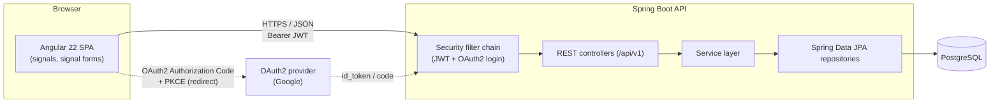
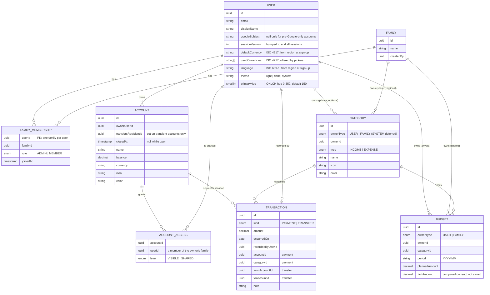

# Family Budget — Architecture

Status: draft v0.13 · 2026-10-07
Frontend (Angular SPA): [frontend ARCHITECTURE.md][frontend-arch]

[frontend-arch]: https://github.com/omarkelovUA/budget-front/blob/main/docs/ARCHITECTURE.md

## 1. Purpose

Family Budget lets a household track money together while each member keeps some of it
private. A user can:

- manage **private** accounts, categories, transactions and budgets visible only to them,
- manage **shared** (family-wide) accounts, categories, transactions and budgets visible to
  every member of their family,
- belong to exactly one family at a time (v1 simplification, see §7).

This document describes the system as a whole and the backend: domain model, REST API,
security and backend structure. It is intentionally stack-accurate but
implementation-light.
The Angular SPA has its own [frontend ARCHITECTURE.md][frontend-arch]; §4 lists only what
the backend expects from it.

## 2. High-level system



- **Frontend** is a single Angular SPA (see [frontend ARCHITECTURE.md][frontend-arch]).
- **Backend** is a single Spring Boot modular-monolith (not microservices — scope doesn't
  justify the operational cost yet; see §8 for the tradeoff).
- **Auth** is Google-only (OAuth2/OIDC): the web and mobile entry points both resolve to
  the same backend-issued JWT session, and the first sign-in creates the account. See §6.
- **Database** is one PostgreSQL instance; one schema, Flyway-versioned.

## 3. Domain model

### 3.1 Entities



### 3.2 Ownership / sharing rule

**Accounts** (since M12) have exactly one owner, a user. The owner decides per family
member what they get, stored in `account_access`:

| Member's level | Sees the account, balance, transactions | Records transactions on it |
|---|---|---|
| none (default, no row) | no | no |
| `VISIBLE` | yes | no |
| `SHARED` | yes | yes |

An account without grants is private. One account can be visible to some members, shared
with others and hidden from the rest. The API reports the caller's level as `access`
(`owner | shared | visible`); only the owner gets the `grants` list.

- Only the owner edits an account, changes its grants, closes or deletes it
  (`403 not-account-owner`). Grants can change at any time.
- Grants only go to other current members of the owner's family
  (`409 grantee-not-in-family`). When a user stops being a member (leaves, is removed,
  or moves family through an invitation or join request), the family module
  publishes `FamilyMembershipEnded`. The account module then deletes every grant the user
  gives or holds, synchronously in the same database transaction. The accounts stay with
  their owner.
- Recording on an account needs ownership or `SHARED`. A transfer needs it on **both**
  sides; a `VISIBLE` account takes no transactions in either direction
  (`403 account-read-only`).
- **Closing** (`POST /accounts/{id}/close {targetAccountId}`) is how an owner gets rid of
  an account that has history. A non-zero balance moves to the target as a transfer;
  a negative balance is pulled from it. The target needs the same currency
  (`409 currency-mismatch`) and must be usable by the owner; it is required unless the
  balance is zero (`409 close-target-required`). Then `closed_at` is set and all grants
  are dropped. Closed accounts disappear from lists (the owner sees them with
  `?closed=true`). They take no new transactions, and transactions touching them can't be
  deleted (`409 account-closed`). `DELETE` only works for accounts without transactions
  (`409 account-in-use`).
- V10 migrated the old family-owned accounts: owner = the family's longest-standing
  admin, everyone else `SHARED`.

**Categories and budgets** keep the polymorphic owner: `ownerType` + `ownerId` instead
of a boolean "shared" flag.

- `ownerType = USER, ownerId = <userId>` → private, visible only to that user.
- `ownerType = FAMILY, ownerId = <familyId>` → shared, visible to every member of that
  family.

This avoids duplicating each table into `*_private` / `*_shared` variants and keeps
authorization logic in one place (see §6.3).

**Transactions** have no owner of their own; what a caller may do follows from their
access to the account(s) a transaction touches:

- **Visible** to anyone who can see *at least one* of its accounts. A family member
  therefore sees Alice's transfer from her private card into an account shared with them,
  with the card shown as a reference (name, currency, icon, color, `access: none` —
  never its balance).
- **Deletable** when the caller has ownership or `SHARED` on *all* of its (open)
  accounts, **and** either recorded it or owns one of those accounts. Otherwise the
  answer is `403 transaction-not-editable`. Responses carry `editable` so clients don't
  repeat the rule.
- Transactions are immutable: correcting one means deleting and re-creating it.
- **Splitting** (`POST /transactions/{id}/split {parts: [{id?, categoryId, amount}]}`,
  `201` with the new transactions) replaces a payment with 2–50 independent payments on
  the same account, date and note, recorded by the same person, in one database
  transaction. The parts must add up to the original (`400 split-total-mismatch`) and use
  accessible categories of its type, so the balance doesn't move; transfers can't be split
  (`invalid-transaction`). It's allowed whenever deleting the payment is. Nothing links the
  parts afterwards; the sync feed reports the original as deleted and the parts as new. A
  retry whose first part id already exists returns the parts made the first time (§5.3).
  Recording or deleting a transaction adjusts the touched balances in the same database
  transaction (atomic `balance = balance + delta`).
- A payment's direction comes from its category type (income adds, expense subtracts);
  amounts are always positive. Transfers require both accounts to share a currency.

Other ownership rules:

- A budget's visibility (private/shared) is fixed at creation, and so is a category's
  in a `PUT` (`409 visibility-immutable`). A category's income/expense type is fixed too,
  because it determines what past payments did to balances.
- **Family categories** (M22) are shared by every member, live (no copies):
  - Only the admin updates, deletes or hides one (`403 admin-required`); every member
    records payments and sets budgets on it.
  - Any member adds one: created as `shared`, or their own made one with
    `POST /categories/{id}/share`. A non-admin's addition is live at once and recorded in
    `added_by`; the admin reads `GET /categories/added-by-members` (the app shows a
    message) and clears it with `POST /categories/added-by-members/seen`.
  - `POST /categories/{id}/hide` (admin) makes it the admin's personal category. The
    category module publishes `CategoryHiding` first; the transaction and budget modules
    refuse with `409 category-used-by-family` while anyone else has payments or budgets
    in it.
  - **No duplicates:** a user never sees two categories with the same type and name
    (case-insensitive): creating or renaming into one is refused (`409 category-exists`),
    and a member's personal namesake of a family category is merged into it
    (`CategoryMerged`: the transaction and budget modules repoint their rows, a budget
    that would collide is dropped, then the personal copy is deleted). Merging runs when
    someone joins (`FamilyMembershipStarted`), a category is shared, and a family category
    is renamed.
  - Someone else's personal category, seen through a payment on a shared account, comes
    back as `{id, type, unknown: true}` with empty name, icon and colour.
  - The admin reviews once which categories the family sees, when its first other member
    arrives: `FamilyView.categoriesReviewed`, set by
    `POST /families/current/categories-reviewed` (V20 set it for families that already
    had members).
- Creating something `shared` without a family fails with `409 no-family`. Since M19
  every user has a family, so this is only a guard.
- Categories that are still referenced (transactions, budgets) can't be deleted
  (`409 category-in-use`), enforced by foreign keys.
- A category's or budget's `owner_id` has no foreign key (it points at users *or*
  families). When a family is deleted (its last member moves to another family through
  an invitation or join request), the family module publishes `FamilyDeleted`. The category
  and budget modules then turn that family's categories and budgets into the last
  member's private ones, synchronously in the same database transaction. They can't
  simply be dropped, because transactions still reference the categories, and the last
  member was the only person who could see them anyway. V12 did the same for families
  deleted earlier: owner = whoever recorded the category's latest payment; orphans
  without any transactions were deleted.
- `SYSTEM`-owned default categories are deferred: the frontend's `Visibility` type has no
  value to show them with.

**User settings** (`GET`/`PUT /users/me/settings`, M13 + M15 + M16 + M17):
`{language, defaultCurrency, usedCurrencies, theme, primaryHue}`; `PUT` replaces all five.
`theme` is `light`, `dark` or `system` (follow the device; the default), anything else
fails with `400 unsupported-theme`. `primaryHue` is the OKLCH hue (0–359) the UI
palette derives from; new users get 150 (a "dollar" green), and a missing or
out-of-range value is a `400` validation error. The others are set at
sign-up from the client's `Accept-Language` (an old account that gets linked to Google
keeps its settings):
- `defaultCurrency`: the first locale whose country has a currency wins; a language
  without a country stands for its main country (`uk` → UA, `pl` → PL, …; widely shared
  languages like `en` are skipped); otherwise UAH. Unknown codes fail with
  `400 invalid-currency`.
- `language` (ISO 639-1, the UI language): the first locale with a supported language
  (`SupportedLanguage`: `en`, `uk`) wins, else a country whose language is supported
  (`ru-UA` → `uk`), else `en`. Others fail with `400 unsupported-language`. Users from
  before M15 got `uk`, the UI's only language until then.
- `usedCurrencies`: the currencies the user's pickers offer, in order, 1–20 of them,
  duplicates dropped; starts as `[defaultCurrency]`, which it must always contain
  (`400 default-currency-not-used`). It doesn't restrict which currency an account can
  have.

**Family transfers** (M14) let members send each other money even when the receiver's
accounts are hidden from the sender. Each ordered pair (sender → recipient) and currency
has a **transient account**: a row in `accounts` owned by the sender, with
`transient_recipient_id` set, and at most one open per pair and currency.

- **Creation:** when someone joins a family (`FamilyMembershipStarted`), transient
  accounts are created with every other member in both directions, each in the
  **sender's** default currency. Other currencies are created on the first send.
- **Moving money** (`/family-transfers`):
  - *send:* the sender's own account → transient;
  - *collect:* transient → the recipient's own account;
  - *take back:* transient → the sender's own account.
  
  Each step is a plain transfer, so in-transit money keeps counting for the sender. The
  accounts at either end must be owned by the caller and use the transient account's
  currency. Withdrawals are conditional updates, so a transient account never goes
  negative (`409 insufficient-in-transit`).
- **Off-limits otherwise:** transient accounts never appear in account lists. They can't
  be used in generic transactions, edited, closed or used as a close target
  (`409 transient-account`). Transactions touching them can't be deleted.
- **Leaving:** when either side leaves the family (`FamilyMembershipEnded`), money still
  in transit is written off as the sender's expense, as a payment in their auto-created
  private category "Перекази в сім'ї", and the transient account is closed.

**Month summary** (`GET /transactions/summary?period=YYYY-MM`, backs the dashboard):
income and expense totals of the payments the caller can see in that month, one row per
account currency — never summed across currencies (no FX, §7). Transfers are excluded:
they move money between accounts and are neither income nor expense. Computed with one
grouped query over every account the caller can see (owned, shared or visible, closed
ones included so past months stay correct).

**Budgets** are monthly, one per owner/category/month. `factAmount` is the sum of the
category's payments in that month, computed on every read (indexed on
`(category_id, occurred_on)`): a **private** budget counts only its owner's own payments,
a **shared** budget counts every member's. A shared budget must use a shared category, so
every member can see what it tracks.

Every user belongs to exactly one family in v1 (M19). There is no `activeFamilyId`
column on the user: `family_members` is keyed by `user_id`, so the membership row *is* the
user's current family (one source of truth, nothing to keep in sync). Other modules ask
`FamilyService.currentFamilyId(userId)`.

- **Own family:** sign-up (a first Google login) publishes `UserRegistered`, and the family
  module creates the user's own family in the same transaction: named "Family", or
  "Родина" for Ukrainian, with the user as its only member and admin. V18 gave one to
  every existing user without a family. There's no endpoint to create a family.
- **Starting data** (M21): `UserRegistered` also gives the user two accounts (Cash,
  Card) in their default currency with a zero balance, and eight family categories (six
  expense, two income; shared by default, M22), named in the sign-up language. The
  account and category modules create them (`DefaultAccountSetup`, `DefaultCategorySetup`,
  ordered after `DefaultFamilySetup`); they're ordinary data the user edits, hides or
  deletes.
- **Rename:** admins rename it (`PATCH /families/current {name}`).
- **Leaving** (`POST /families/current/leave`) and **being removed**
  (`DELETE /families/current/members/{id}`) put the user in a new family of their own,
  with the default name; leave returns it. Leaving while alone is refused
  (`409 alone-in-family`). If the only admin leaves, the longest-standing remaining
  member becomes admin. Demoting the last admin is still refused (`409 last-admin`).

**Invitations** are keyed by email. An admin invites an address (it doesn't need an
account yet); the invitation shows up for whoever signs in with that email
(`GET /invitations`) and is valid for 7 days. Nothing is emailed: the web and (later)
mobile clients list pending invitations themselves.

- Only a user whose email is verified may list, accept or decline invitations
  (`403 email-not-verified`), i.e. one linked to Google. Every account is, except those
  left from when password registration existed and never verified the email.
- Accepting moves the user: they leave their current family first. If they were its last
  member, that family is deleted; if they were its only admin, the longest-standing
  remaining member becomes admin.
- A family has at most **10 seats**: members plus pending invitations. Inviting fails with
  `409 family-full`; revoking a pending invitation frees its seat. Invites and accepts
  lock the family row, so concurrent ones can't overshoot the limit.
- One pending invitation per family and email (`409 already-invited`); inviting a current
  member fails with `409 already-member`. Declined, revoked and accepted invitations are
  kept with their status for history. Multi-family-per-user is listed as a v2 idea, not built now (§7); it would bring
back an explicit active-family choice.

**Join requests** (M19) go the other way: a user alone in their family asks to join the
family of someone they name by email (`POST /join-requests {email}`), and that family's
admins answer (`GET /families/current/join-requests`, `POST …/{id}/approve`,
`POST …/{id}/decline`).

- Asking needs a verified email (`403 email-not-verified`): the admins decide by the
  requester's name and email. It also needs the requester to be alone (`409 not-alone`),
  the email to belong to a user (`404 user-not-found`) in another family
  (`409 already-member`).
- One open request per requester, valid 7 days (`409 already-requested`). The requester
  sees it at `GET /join-requests/mine` (`204` when there is none) and cancels it with
  `DELETE /join-requests/mine`. Answered, cancelled or expired requests give
  `404 invalid-join-request`.
- Approving moves the requester in as a member, like accepting an invitation (their
  one-person family is deleted, `FamilyMembershipStarted` is published). Requests don't
  reserve a seat, so approving checks the limit (`409 family-full`).
- When someone joins a family, open requests made by its members are closed: they asked
  while alone, which they no longer are.

**Custom order** (M24): each user orders the open accounts and the categories they see,
for themselves only. `PUT /accounts/order` and `PUT /categories/order` take the whole
order (`{ids}`; duplicates `400 validation-failed`, ids the user can't see
`404 not-found`) and replace the user's rows in `account_positions` /
`category_positions`. The lists sort by them; items without a position (new ones, newly
shared ones) come after, in the default order (accounts oldest first, categories by type
and name). `common.UserOrder` reads, replaces and applies them for both modules.

### 3.3 Relationship to current frontend types

The API follows the frontend's `model/types.ts` (as of M8) rather than the database
shape: `visibility: 'private' | 'shared'` instead of `ownerType`/`ownerId` for categories
and budgets (accounts send `owner`, `access`, `grants` and `closed` instead, §3.2), and
lower-case enum values (`'income'`, `'payment'`, `'admin'`, …). Differences the M9
integration absorbed — the frontend types now use string ids and an `IAccountRef` for
transaction accounts, and the `Http*Repository` classes do the remaining mapping, so the
repository contracts stayed as they were:

- Ids are UUID strings, not `number`.
- Transaction `date` is an ISO `YYYY-MM-DD` string; transactions also carry `kind`
  (`'payment' | 'transfer'`), `note` and `recordedBy`. Their accounts are `AccountRef`s
  (no `balance`), and the unused pair (`account`/`category` vs. `fromAccount`/`toAccount`)
  is omitted from the JSON, so the frontend's `isTransferTransaction` check still works.
- Creating a transaction sends ids (`accountId` + `categoryId`, or `fromAccountId` +
  `toAccountId`) plus `kind`, not embedded objects.
- Creating/updating a budget sends `categoryId`, not an embedded category.
- `GET /transactions` returns a page wrapper (§5.3), not a bare array.
- The current user (`GET /users/me`) has no `familyId`; the family comes from
  `GET /families/current` (every user has one since M19).

### 3.4 Family subscriptions

Growing a family is the paid part of the app, sold as a Google Play subscription in the
Android app (one product, `family_sharing`, with monthly and yearly base plans and a
trial; prices live in Play Console). The `subscription` module keeps one
`subscriptions` row per Play purchase or manual grant.

- **Entitled family:** at least one of its current admins has a subscription that
  entitles them now. That means a state of `active`, `in_grace` (Google retrying a failed
  renewal) or `canceled` (won't renew), and not past `expires_at`. A manual grant counts
  the same way; its `expires_at` may be null (no end). A member's own subscription
  doesn't count, and the subscription follows its buyer: if they leave or stop being an
  admin, the family loses it. Entitlement is computed on every request (no cache), so a
  database change shows at once.
- **Adding members needs it:** inviting, accepting an invitation into the family and
  approving a join request get `403 subscription-required` otherwise.
- **Frozen family:** more than one member and not entitled. Shared data turns read-only,
  with `403 family-frozen` on:
  - creating or sharing family categories, changing, deleting or hiding them;
  - creating, changing or deleting shared budgets;
  - recording on, or deleting transactions from, an account the caller doesn't own (their
    `editable` turns false);
  - giving new or wider grants on an account;
  - sending a family transfer.

  Everything else works: private data, the caller's own accounts (with family categories
  too), narrowing grants, collecting and taking back money in transit (so it isn't
  stuck), reading, leaving, removing members, changing roles, subscribing. A one-person
  family is never frozen. `AccessScope.frozen` carries the state to the category, budget
  and transaction services; accounts and transfers ask `FamilyService.isFrozen`.
- `GET /families/current` includes `entitled` and `frozen`. `GET /subscriptions/me`
  returns the caller's longest-lasting entitling subscription, else their latest one,
  else `204`: `{source, state, productId, basePlanId, expiresAt, autoRenewing, active}`,
  with `source` `google_play` or `manual`.

**Buying** happens in the app with the Play Billing Library. The app tags the purchase
with an obfuscated account id: the SHA-256 of the user id, lower-case hex
(`SubscriptionService.accountIdFor`). It then sends the token to
`POST /subscriptions/google-play {purchaseToken}`.
- The backend reads the purchase from the Play Developer API
  (`purchases.subscriptionsv2.get`, as the service account in `GOOGLE_PLAY_CREDENTIALS`).
- It refuses a purchase tagged for someone else, or a token already stored for another
  user, with `400 invalid-purchase`; a token Play doesn't know gets the same.
- Otherwise it stores the row and acknowledges the purchase (Play refunds purchases left
  unacknowledged for 3 days; a `pending` one waits until it's paid).
- A purchase that replaces another (upgrade, resubscribe: Play's `linkedPurchaseToken`)
  marks the old row `expired`.
- If Play can't be reached, or no credentials are configured, it's
  `503 google-play-unavailable`. Sending a token again is harmless, so the app retries
  unacknowledged purchases on start.

**Keeping up to date:** Google's real-time developer notifications arrive through
Pub/Sub as pushes to `POST /webhooks/google-play`, authenticated as in §6.1.
- The message is only a pointer: the backend re-reads that purchase from Play.
- Test notifications, other apps' notifications and tokens no app has reported yet get a
  `204` too, so Pub/Sub doesn't retry them.
- `SubscriptionRecheck` re-reads, every night, Play rows expiring within 3 days or
  already past expiry but not marked `expired`, in case a notification was lost.

**Manual grants** (testing, and the operator page, §3.5) are rows with `source = 'MANUAL'`.
The table's defaults keep the SQL short:

```sql
-- grant (no end; set expires_at for a dated one)
INSERT INTO subscriptions (user_id, source, state)
SELECT id, 'MANUAL', 'ACTIVE' FROM users WHERE email = 'someone@gmail.com';
-- revoke
DELETE FROM subscriptions s USING users u
WHERE s.user_id = u.id AND s.source = 'MANUAL' AND u.email = 'someone@gmail.com';
```

### 3.5 Operator page

Whoever runs the service (the **operator**; "admin" stays the family role) gets a web page
with usage numbers and the manual grants (§3.4). The `operator` module serves it; it reads
the other modules through their services, and nothing depends on it.

- **Who's an operator:** `APP_OPERATOR_EMAILS` (comma-separated) names them by email.
  Only a Google-linked account counts, so the email is the one Google verified. Nothing is
  stored. `GET /users/me` says `operator: true|false`; every `/operator/**` call by anyone
  else gets `403 operator-required`.
- **Activity:** a user is active on a day (UTC) when one of their sessions starts or
  refreshes, web or mobile. `RefreshTokenService.issue` records it in `user_activity`, one
  row per user and day (V26; an insert that ignores duplicates).
- **`GET /operator/stats`:**
  - `users`: `total`, `newLast7Days`, `newLast30Days`, `activeLast30Days`, and over the
    last 30 days (oldest first, every day listed) `signups` and `activeUsers` as
    `{day, count}`;
  - `families`: `withMembers` (more than one member), `frozen`;
  - `subscriptions`: users entitled now through Play (`activeGooglePlay`) and manual
    grants (`activeManual`), and Play purchases by state (`googlePlayByState`).
- **Manual grants:**
  - `GET /operator/grants` lists them with the user's email and name, `expiresAt` (null:
    no end) and `active`.
  - `POST /operator/grants {email, expiresAt?}` gives a grant, or changes the end of the
    one the user has (`404 user-not-found` for an unknown email).
  - `DELETE /operator/grants/{userId}` takes it back (`404 not-found` without one).
  - They're the same rows as the SQL in §3.4.

## 4. Client contract

The Angular SPA (its stack, structure and auth handling) is described in the
[frontend ARCHITECTURE.md][frontend-arch]. What the backend relies on from it:

- It holds the access token in memory only and calls `POST /auth/refresh` (cookie-based)
  on startup and after a 401, sharing one refresh between concurrent 401s since every
  refresh rotates the cookie (§6.2).
- Google login is a full-page navigation to `/oauth2/authorization/google`; the backend
  redirects back to the SPA's `/auth/callback` (§6.1).
- It switches on the `ProblemDetail` `type`, not the HTTP status (§5.4), so problem types
  are part of the API contract.
- In local dev `ng serve` proxies `/api`, `/oauth2` and `/login/oauth2` here, so the
  browser sees one origin — no CORS, and the refresh cookie (`Path=/api/v1/auth`,
  `SameSite=Strict`) behaves as in production (§6.4).

The Android app (`budget-app-mobile`) is the **main client**: every user has it, and only
some also use the web. It covers everything the SPA does, family administration included,
with the family actions online only. It works offline on its own
database, and sync is opt-in. It signs in with Google only: it sends the ID token it got
from Credential Manager to `POST /auth/google/mobile` and keeps both of our tokens itself,
refreshing once per 401 through `/auth/mobile/refresh` (§6.1, §6.2). Syncing, it replays
its queued writes through the normal endpoints with its own ids (§5.3), then pulls
`/sync/changes` (§6.5).
- It sends the account's current balance and grants back with an account update, so a
  `PUT` from the phone never undoes payments or unshares the account.
- It treats every 4xx except 401 as a refused change and takes the server's state.
- Problem types reach it the same way as the SPA.

## 5. Backend architecture (Spring Boot)

### 5.1 Stack

- Spring Boot 4.1.x (Spring Framework 7, Spring Security 7, Hibernate 7 / JPA 3.2,
  Jakarta EE 11), Java 25 (LTS). Maven.
- Spring Web MVC (REST), Spring Security (OAuth2 Resource Server for JWT validation,
  OAuth2 Client for Google login), Spring Data JPA, Flyway, Bean Validation, Actuator.
- Spring Modulith 2.x to verify module boundaries in tests (§5.2).
- PostgreSQL 18 (Docker Compose for local dev, auto-started via
  `spring-boot-docker-compose`).
- Entity↔DTO mapping is hand-written (`toView()` methods / small records) while mappings
  stay trivial; MapStruct was considered but skipped in M7 — revisit if M8's DTOs grow
  enough to make it pay off.
- Jackson 3 (`tools.jackson.*`) is Boot 4's default; any custom (de)serializers target it.
- JSpecify `@Nullable`/`@NonNull` for null-safety in our own code, matching Spring 7.
- Testing: JUnit 5 + Testcontainers 2.x (real Postgres in integration tests, not H2).
- Boot 4 split auto-configuration into finer-grained modules: each technology needs its
  own starter (e.g. `spring-boot-starter-flyway`, not just `flyway-core`), and several
  classes moved packages (e.g. `EndpointRequest` →
  `org.springframework.boot.security.autoconfigure.actuate.web.servlet`) — older Boot 3
  examples won't compile as-is.

### 5.2 Module / package layout

Package-by-feature at the top, layers inside: each domain's controller/service/repo/
entity/dto stay together in one module, split by layer within it:

```
com.familybudget
  common/            # ProblemDetail error handling, pagination, @CurrentUserId (open module)
  security/          # JWT filter, OAuth2 success handler, JWT issuing/validation, roles
  user/              # User entity, registration, profile
  family/            # Family, FamilyMembership, email invitations, join requests
  account/
  category/
  transaction/
  budget/
  subscription/      # Play purchases, Google's notifications, manual grants (§3.4)
  operator/          # the operator page's numbers and manual grants (§3.5)
  sync/              # the mobile app's change feed (§6.5); depends on all of the above

com.familybudget.<module>
  controller/        # REST controllers
  service/           # *Service plus event listeners (setup, sync, handover, cleanup)
  repository/        # Spring Data repositories
  entity/            # JPA entities
  model/             # views, requests, refs, enums
  event/             # events other modules listen to
  config/, web/      # where a module has them (security, common, user)
```

A module's API is its `service`, `model` and `event` packages, each marked
`@NamedInterface`. `controller`, `repository` and `entity` are internal: their classes are
`public` (the layers sit in different packages) but Spring Modulith fails the build if
another module touches them. Cross-feature calls go through the other feature's
`*Service`, never its repository — keeps future extraction into separate services possible
without a rewrite. Each sub-package of a feature module is `@NullMarked`.

`security` depends on `user` (to find-or-create Google users) and on `subscription` (its
webhook passes Google's notifications on), never the other way round. `family` depends on
`subscription` to decide entitlement; `subscription` depends only on `common`. Controllers in any module get the caller's id via `common`'s
`@CurrentUserId UUID` parameter (the JWT `sub`), so feature modules never depend on
`security`.

Each top-level package is a Spring Modulith application module. `ModularityTests` runs
`ApplicationModules.verify()` so a module reaching into another's internals (e.g. its
repository or entity) fails the build instead of relying on review discipline. `common`
is declared an *open* module since every feature uses it.

### 5.3 API conventions

- Base path `/api/v1`, resource-oriented REST. Full-object updates use `PUT` (the
  frontend's repositories send whole objects); `PATCH` is used only for genuinely partial
  changes (a family member's role, the family's name).
  Decided in M7: `/api/v1` is written directly into each `@RequestMapping`. Spring
  Framework 7's API versioning would need a `{version}` segment in every mapping anyway and
  buys nothing until a `v2` exists; the URL shape is the same either way.
- All list endpoints return only what the caller is authorized to see (own private data
  ∪ their active family's shared data) — enforced in the service layer, not trusted from
  query params.
- Errors as RFC 9457 `ProblemDetail` with a stable `type` URI the frontend can switch on
  (not just an HTTP status), e.g. `https://familybudget.app/problems/email-taken`.
- Pagination via `page`/`size` query params (size 1–200, default 50) on transaction
  lists, returning `{content, page, size, totalElements, totalPages}` — our own
  `PageView` record, not Spring Data's `Page` JSON. Other lists are small and unpaged.
- Money is JSON numbers with two decimals (`NUMERIC(19,2)` in the database).
- **Client ids:** creating an account, category, transaction or budget accepts an
  optional `id` (UUID) from the client, which the mobile app sends so that retrying a
  create is safe (§6.5).
  - If that id already exists and the caller can see the row, the create returns it
    unchanged with the usual `201`, and nothing happens twice (no second balance move).
  - If the caller can't see it, the server answers `409 id-conflict`.
  - If it existed but was deleted since, the server answers `410 already-deleted`, so a
    late retry can't bring the row back (or move a balance again).
  - Without an `id`, the server generates one.
  - A category whose name is already taken still gets `409 category-exists`. The client
    maps its own id to the existing category.

### 5.4 Error handling

A single `@RestControllerAdvice` in `common` translates domain exceptions into consistent
`ProblemDetail` responses. Domain errors are `ApiException(status, type, message)` (with
`NotFoundException` as a shorthand); the `type` slug becomes the problem `type` URI.
Requests Spring MVC rejects before a service runs (Bean Validation failures, unreadable
JSON, wrong or missing parameters) keep its built-in `ProblemDetail`, but with the
`validation-failed` type.
The frontend maps problem types to user-facing messages (§4), so this shape has to stay
stable.

Problem types so far: `not-found`, `invalid-refresh-token`, `email-not-verified`, `unauthenticated`,
`invalid-invite`, `already-invited`, `already-member`, `family-full`, `admin-required`, `last-admin`, `cannot-remove-self`, `no-family`,
`alone-in-family`, `not-alone`, `user-not-found`, `already-requested`, `invalid-join-request`,
`visibility-immutable`, `category-type-immutable`, `account-in-use`, `category-in-use`,
`category-exists`, `category-used-by-family`,
`invalid-transaction`, `split-total-mismatch`, `currency-mismatch`, `transaction-not-editable`,
`category-not-shared`, `budget-exists`, `not-account-owner`, `account-read-only`,
`account-closed`, `grantee-not-in-family`, `close-target-required`, `invalid-currency`,
`transient-account`, `recipient-not-in-family`, `insufficient-in-transit`,
`unsupported-language`, `invalid-used-currencies`, `default-currency-not-used`,
`unsupported-theme`, `invalid-google-token`, `google-unavailable`,
`subscription-required`, `family-frozen`, `invalid-purchase`, `google-play-unavailable`,
`operator-required`,
`id-conflict`, `already-deleted`,
`invalid-sync-cursor`, `validation-failed`.

`detail` texts are English and meant for developers and logs; the backend has no
`MessageSource`. Clients show their own, translated text keyed by the `type` slug (the
frontend: `errors.<slug>` in its translation files).

401/403 raised by the security filters themselves (missing/invalid access token) get the
same shape (`unauthenticated` / `forbidden`) via custom entry point and access-denied
handlers, alongside the standard `WWW-Authenticate: Bearer …` header.

## 6. Security design

### 6.1 Google-only sign-in, one session model

There is no password: signing in with Google is the only way in, and the first sign-in
creates the account (`UserRegistered`, §3). The SPA uses the web flow, the Android app its
own; both end in the same session. Accounts made with a password before (only test data,
V24 dropped `users.password_hash`) still exist and link by email on their first Google
login (§6.2).

```mermaid
sequenceDiagram
    participant FE as Angular SPA
    participant API as Spring Boot
    participant IDP as Google OAuth2

    alt Web Google login (server-side, Spring oauth2Login)
        FE->>API: navigate to /oauth2/authorization/google
        API->>IDP: redirect, Authorization Code + PKCE
        IDP->>API: redirect back to /login/oauth2/code/google?code=...
        API->>IDP: exchange code for id_token (confidential client)
        API->>API: find-or-create User from verified id_token claims
        API->>API: set refresh token (httpOnly cookie)
        API-->>FE: redirect back to the SPA
        FE->>API: POST /api/v1/auth/refresh
        API-->>FE: access token (body)
    else Mobile Google login (Android app)
        FE->>IDP: Credential Manager sign-in (audience: our client ID)
        IDP-->>FE: Google ID token
        FE->>API: POST /api/v1/auth/google/mobile {idToken}
        API->>API: verify signature (Google JWKS), iss, aud, exp; find-or-create User
        API-->>FE: access token + refresh token (both in the body)
    end

    FE->>API: subsequent requests with "Authorization: Bearer <access>"
    API->>API: resource-server JWT support validates signature+expiry, loads auth context
```

Both paths converge on the same backend-issued JWT — the rest of the API never has to
know whether a session started in the browser or the mobile app. This is the key simplification:
OAuth2 is a *login method*, not a parallel authorization system.

The Google flow runs entirely on the backend (Spring's `oauth2Login`, backend as a
confidential client): the SPA never sees the authorization code or Google's tokens. After
login the backend only sets the refresh cookie and redirects to the SPA, which then
obtains its access token through the normal `/auth/refresh` call — so the access token
never travels in a URL.

The mobile path has no redirect to come back to, so the app signs in with Google itself
and the backend checks the resulting ID token (`GoogleIdTokenVerifier`): Google's
signature (keys from `https://www.googleapis.com/oauth2/v3/certs`), issuer
`https://accounts.google.com` or `accounts.google.com`, audience = our
`GOOGLE_CLIENT_ID`, and a non-empty `sub` and `exp`. A bad token gets
`401 invalid-google-token`. If Google's keys can't be fetched, the token may be fine, so
that's logged and answered `503 google-unavailable` instead.

Google Play's notifications (§3.4) come as Pub/Sub pushes to `POST /webhooks/google-play`,
which our access-token check ignores. Instead `GooglePlayPushVerifier` checks the OIDC
token Pub/Sub sends as the bearer, reusing `GoogleIdTokenVerifier`:
- Google's signature and issuer, an audience of `GOOGLE_PLAY_PUSH_AUDIENCE`;
- an `email` equal to `GOOGLE_PLAY_PUSH_SERVICE_ACCOUNT`, with `email_verified`.

Anything else is `401 unauthenticated`; unreachable Google keys stay a `503`, so Pub/Sub
retries.

No hand-written JWT filter: tokens are issued with Spring Security's `NimbusJwtEncoder`
and validated by its OAuth2 Resource Server support (`NimbusJwtDecoder`), signed with an
HMAC key from configuration (`JWT_SECRET`). Switching to an asymmetric key pair later
only changes those two beans.

### 6.2 Token handling

- Short-lived **access token** (HS256 JWT, 15 min, `sub` = user id, plus `email` and
  `sv` = the user's session version), returned in the response body, held in frontend
  memory only (never localStorage, to limit XSS blast radius).
- **Ending all sessions at once**: bumping `users.session_version` makes every access
  token issued before it fail validation on the next request (`SessionVersionValidator`,
  one primary-key lookup per request). `UserSessionsInvalidated` makes the security
  module revoke all of the user's refresh tokens in the same database transaction.
- **Google reclaims an unverified account**: password sign-up, back when it existed,
  never verified the email. So when a Google login (with a Google-verified email) links
  to such an account, all of its sessions end as above: whoever registered the address
  first, possibly not its owner, is locked out. Web and mobile both link straight away,
  without asking (older app versions still send a `confirmLink` field; it's ignored).
- Longer-lived **refresh token** (30 days): an opaque random value, not a JWT, stored
  server-side only as a SHA-256 hash in `refresh_tokens`. Sent as an httpOnly + Secure +
  SameSite=Strict cookie scoped to `Path=/api/v1/auth`, so it only reaches the auth
  endpoints. Rotated on every `/auth/refresh`.
- **Reuse detection**: presenting an already-rotated token is rejected. If it was rotated
  more than 30 s ago (`reuse-grace`) it's treated as stolen and *all* of that user's
  refresh tokens are revoked; within the grace window (e.g. two tabs refreshing at once)
  it's just rejected, so the other tab's fresh token keeps working.
- **Mobile tokens travel in the body**: the app has no cookie jar, so
  `/auth/google/mobile` returns the refresh token in the JSON, and
  `POST /auth/mobile/refresh` and `/auth/mobile/logout` take `{refreshToken}` in the body.
  They never set a cookie. Rotation, reuse detection and expiry are the same as for the
  cookie.
- **Logout** revokes the presented refresh token in the database and clears the cookie.
  Its access token isn't denylisted — it simply expires within 15 min (only a session
  version bump ends access tokens early).
- The auth endpoints ignore any `Authorization` header, so the SPA can call
  `/auth/refresh` with an expired access token still attached.
- A daily job (`RefreshTokenCleanup`, cron `app.security.refresh-token.cleanup-cron`)
  deletes tokens past their expiry. Revoked-but-unexpired rows are kept deliberately:
  replaying one is what triggers reuse detection.

### 6.3 Authorization (private vs. shared data)

- Every request carries the authenticated `userId` (from JWT) resolved server-side to
  their current family via `FamilyService.currentFamilyId(userId)` (§3.2).
- Account queries are scoped to "owned by the caller, or the caller has a grant"; grants
  only ever exist inside one family and are revoked when membership ends (§3.2).
  Transactions are scoped through the accounts the caller can see.
- Category and budget queries are scoped to
  `ownerType=USER AND ownerId=:userId OR ownerType=FAMILY AND ownerId=:activeFamilyId`.
- Both are centralized in the service layer (§5.2) so no controller can accidentally
  leak cross-family data.
- Mutating an account requires being its owner; recording on it requires ownership or
  `SHARED` (§3.2). Mutating a `FAMILY`-owned category or budget checks the caller is a
  member (any role) of that family; family-management actions (rename, invite, remove
  member, change role, answer join requests) require `ADMIN`.
- A family always keeps at least one `ADMIN`: the last admin can't be demoted, and if
  they leave, the longest-standing member takes over. A family is deleted only when its
  last member moves to another one.
- Adding members needs an admin's subscription, and a family with members but none is
  frozen: its shared data is read-only (§3.4).
- Email invitations and join requests can only be used by an account whose email is
  verified (Google-linked), since the email is the only thing tying them to a person
  (§3.2).

### 6.4 Transport/infra

- HTTPS in any deployed environment. Local dev runs on plain `http://localhost`: browsers
  treat localhost as a secure context, so the `Secure` refresh cookie still works there
  (`REFRESH_COOKIE_SECURE=false` is the escape hatch). mkcert was the original idea and
  turned out unnecessary.
- CORS restricted to the known frontend origin(s) per environment. It's unused both in
  local dev (`ng serve` proxies the API) and in production (Caddy serves the SPA and the
  API from one origin), so everything is same-origin.
- Packaging: multi-stage `Dockerfile` (JDK build → layered JRE runtime, non-root user).
  `compose.yaml` runs Postgres for `spring-boot:run`, plus the backend itself behind the
  opt-in `app` profile.
- Production: one Docker host (an Azure Ubuntu VM) running `deploy/compose.yaml`:
  - `web`: the frontend image, Caddy with the SPA. It terminates TLS (automatic Let's
    Encrypt), redirects HTTP to HTTPS, serves the SPA with an `index.html` fallback, and
    proxies `/api/*`, `/oauth2/*`, `/login/oauth2/*` and `/actuator/health*` to `api`.
    The only service that publishes ports (80, 443).
  - `api`: this image, with `SERVER_FORWARD_HEADERS_STRATEGY=native` so Tomcat trusts
    Caddy's `X-Forwarded-*` headers and the Google redirect URI comes out as
    `https://<domain>/login/oauth2/code/google`. The other actuator endpoints aren't
    proxied.
  - `db`: PostgreSQL 18 on a named volume. `deploy/backup.sh` writes a daily `pg_dump`
    and can upload it to Azure Blob storage.
  - Secrets and the deployed image tags live in `.env` on the host
    (`deploy/.env.example`).
- CI: GitHub Actions in each repo — backend `./mvnw verify` (Testcontainers on the
  runner's Docker) and an image build; frontend build + unit tests. On `main` each repo
  also pushes its image to GHCR (`ghcr.io/omarkelovua/budget-backend|budget-front`,
  tagged with the commit SHA and `latest`). It then SSHes to the host as `deploy`, runs
  `deploy/deploy.sh <api|web> <sha>` and smoke-tests `/actuator/health` (or `/`).
  Rollback is `deploy.sh` with an older SHA. The step-by-step VM setup is in the
  README's *Production* section.

### 6.5 Mobile sync

The Android app works offline on its own database and syncs when it can. It pushes its
queued writes through the normal endpoints, using client ids (§5.3). It then pulls with
`GET /api/v1/sync/changes?since=<cursor>`, which returns what changed for the caller
since that cursor.

**Change tracking (`V22`).** Triggers keep three records:
- **`sync_txid`:** every row of `accounts`, `categories`, `transactions`, `budgets`,
  `users` and `families` carries the id of the transaction that last wrote it
  (`pg_current_xact_id()`). It is set on insert and on every update, including the bulk
  balance updates.
- **`sync_tombstones`:** a deleted row leaves its id and `scope_ids`, whose data it was:
  - the owner user, for accounts
  - the owning user or family, for categories and budgets
  - the touched accounts, for transactions

  A category or budget moved to another owner, for example hidden by the admin, leaves a
  tombstone for its old owner.
- **`sync_markers`:** per-user events.
  - `RESET` when what someone may see changed: their grants (`account_access`), or
    membership and roles in their old or new family (`family_members`). Every member of
    both families gets one.
  - `ACCOUNT_ORDER` and `CATEGORY_ORDER` when their custom order changed.

**The cursor** is `<generation>.<horizon>`. The horizon is
`pg_snapshot_xmin(pg_current_snapshot())`: the oldest transaction still running when the
request is served. A window covers `since <= sync_txid < horizon`.
- Every transaction below the horizon has finished, so no row stamped there can appear
  later.
- A row written by a transaction still running is picked up by the next call.
- A sequence or the largest txid seen would not be safe: a slow transaction could commit
  a lower number after the client had already moved past it.
- Transaction ids belong to one PostgreSQL cluster. They start over in a cluster restored
  from a `pg_dump`, so old cursors would skip changes there. `sync_generation` (V23) is
  the generation part of the cursor: **bump it after every restore**
  (`UPDATE sync_generation SET generation = generation + 1`), and every client downloads
  everything again.
- A session left open inside a transaction that has written something holds the horizon
  back for everyone until it ends, so no change above it is delivered.

**The answer.**
- **`accounts`, `categories`, `transactions` and `budgets`:** rows changed in the window
  that the caller can see, in the same views as the list endpoints. Each module answers
  for its own tables (`*Service.changes`).
- **`deleted`:** for each of those four, the tombstones in the caller's scope, plus
  changed rows the caller no longer sees. Closing or deleting a shared account removes
  its grants, so grantees get a reset instead.
- **`settings`:** sent when the caller's `users` row changed.
- **`family`:** sent when the family's row or a member's `users` row changed.
- **`accountOrder` / `categoryOrder`:** sent when their marker is in the window.
- **`resetRequired: true`:** comes with a fresh cursor and nothing else, in three cases:
  - `since` is missing (first sync)
  - a `RESET` marker for the caller falls in the window
  - the window holds more than 1,000 changes (a long time offline). Each module first
    counts its changed ids and tombstones against what's left of that budget, and only
    then builds views.

  The app then downloads everything through the list endpoints and continues from that
  cursor.
- **An unreadable cursor:** `400 invalid-sync-cursor`.

**Not covered.**
- A budget's `factAmount` is correct when sent, but isn't re-sent when someone else's
  payment changes it. The app refreshes shared budgets online.
- Transfers into and out of transient accounts are in `transactions`, but the transient
  accounts and the in-transit view (`/family-transfers`) aren't in the feed. Their
  creates take no client id: they're online-only on mobile.
- Tombstones and markers aren't purged yet.

## 7. Explicit v1 simplifications (revisit later, not now)

- One active family per user (no multi-family switching).
- Single currency assumed per account; no cross-currency conversion/FX.
- Budgets are monthly (`period = YYYY-MM`); no custom date ranges yet.
- No recurring-transaction scheduler.
- `Budget.factAmount` is computed on read (one aggregate query per budget) instead of
  cached — always correct, cheap at v1 volumes; cache it only if budget lists get slow.
- Transactions are create/delete only; no in-place edits.
- Closed accounts can't be reopened, and an account's ownership can't be handed to
  another member; an owner who leaves the family keeps their accounts.

## 8. Key decisions & why

| Decision | Choice | Why |
|---|---|---|
| Repos | Two repos (`budget-app-front`, `budget-app-backend`) | Different stacks/lifecycles/CI; a monorepo buys nothing here since there's no shared build tooling between Angular and Spring Boot. Each repo documents its own side; system-wide design lives in this doc. |
| Backend topology | Modular monolith | Family Budget's scope (a handful of bounded contexts, one team) doesn't justify microservice operational cost. Package-by-feature keeps a future split possible. |
| Sharing model | Polymorphic `ownerType/ownerId` on Category/Budget | One mental model and one authorization check path instead of duplicated private/shared tables or scattered boolean flags. |
| Account sharing (M12) | One owner per account + per-member `VISIBLE`/`SHARED` grants | Families wanted to show an account to some members, let others record on it and hide it from the rest. A single family-owned flag can't express that, and an account always has someone responsible for it. |
| Auth | JWT access token (body) + refresh token (httpOnly cookie); OAuth2 as alternate login only | Standard, well-understood SPA pattern; OAuth2 complexity isolated to the login step instead of leaking into every authorization decision. |
| Backend version | Spring Boot 4.1 / Java 25 | The whole 3.x line left OSS support on 2026-06-30 (3.5 was the last); starting a new project on it would mean starting unsupported. Java 25 is the current LTS. |
| JWT handling | Spring Security resource server + `NimbusJwtEncoder`, not a custom filter | Less security code of our own to get wrong; key rotation/asymmetric keys become a bean swap. |
| Module boundaries | Spring Modulith verification in tests | Turns the "only call another feature's service" rule (§5.2) into a failing build instead of a convention. |

## 9. Open questions

- Purge old sync tombstones and markers (§6.5).
- The write-off category "Перекази в сім'ї" is found by name; translating it needs a
  `system_key` column so a rename per language doesn't create duplicates.
- No email is sent for invitations or join requests; the invitee sees them after
  signing in.
- Not yet checked by hand: a real Google sign-in from the web and the phone, and the
  two-user run-through (invite, accept, share an account, record, transfers, close).
- The production VM isn't set up yet (README *Production*).
