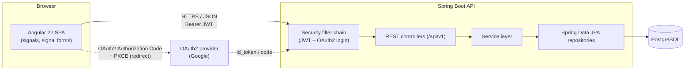
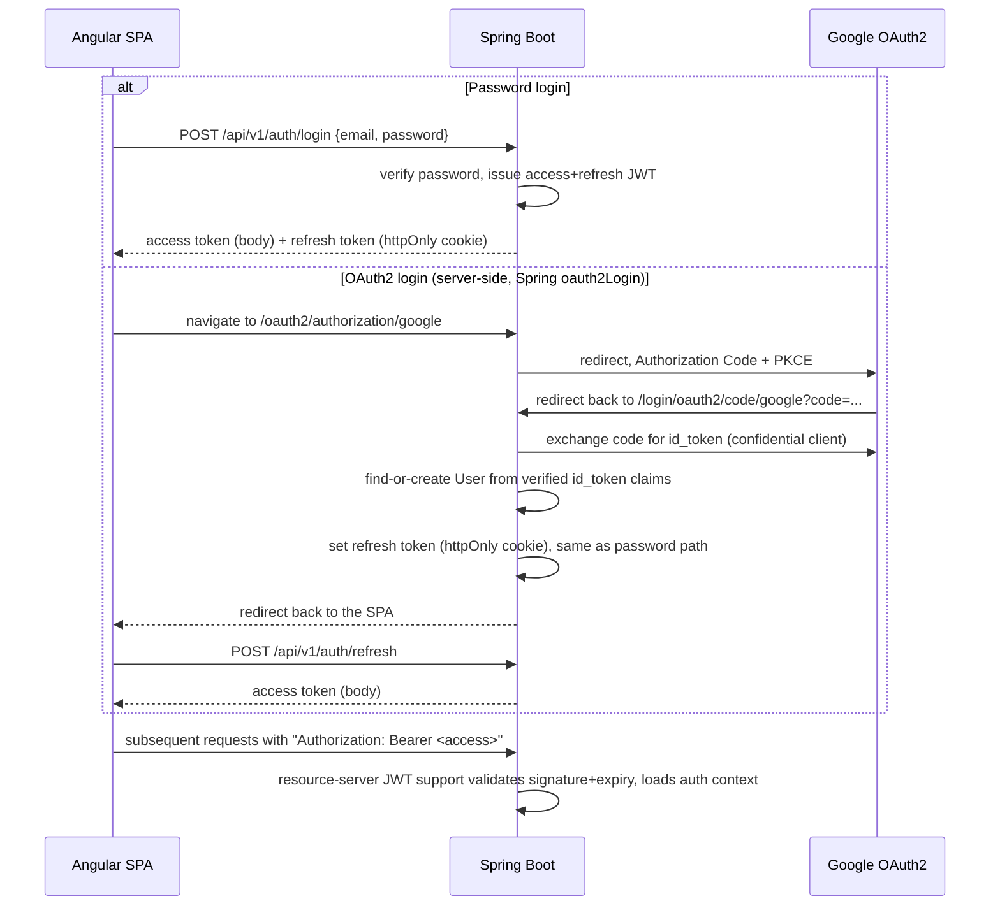

# Family Budget — Architecture

Status: draft v0.13 · 2026-10-07
Companion doc: [PLAN.md](../../.docs/PLAN.md) (workspace `.docs/`) (roadmap, phases, open decisions)
Frontend (Angular SPA): [frontend ARCHITECTURE.md][frontend-arch]

[frontend-arch]: https://github.com/omarkelovUA/budget-front/blob/main/docs/ARCHITECTURE.md

## 1. Purpose

Family Budget lets a household track money together while each member keeps some of it
private. A user can:

- manage **private** accounts, categories, transactions and budgets visible only to them,
- manage **shared** (family-wide) accounts, categories, transactions and budgets visible to
  every member of their family,
- belong to exactly one family at a time (v1 simplification, see §7).

This document describes the system as a whole and the backend: domain model, REST API,
security and backend structure. It is intentionally stack-accurate but
implementation-light — concrete code arrives phase by phase per [PLAN.md](../../.docs/PLAN.md).
The Angular SPA has its own [frontend ARCHITECTURE.md][frontend-arch]; §4 lists only what
the backend expects from it.

## 2. High-level system



- **Frontend** is a single Angular SPA (see [frontend ARCHITECTURE.md][frontend-arch]).
- **Backend** is a single Spring Boot modular-monolith (not microservices — scope doesn't
  justify the operational cost yet; see §8 for the tradeoff).
- **Auth** has two entry points that both resolve to the same backend-issued JWT session:
  password login (JWT) and OAuth2/OIDC login (Google first). See §6.
- **Database** is one PostgreSQL instance; one schema, Flyway-versioned.

## 3. Domain model

### 3.1 Entities

```mermaid
erDiagram
    USER ||--o{ FAMILY_MEMBERSHIP : has
    FAMILY ||--o{ FAMILY_MEMBERSHIP : has
    USER ||--o{ ACCOUNT : owns
    ACCOUNT ||--o{ ACCOUNT_ACCESS : grants
    USER ||--o{ ACCOUNT_ACCESS : "is granted"
    USER ||--o{ CATEGORY : "owns (private, optional)"
    FAMILY ||--o{ CATEGORY : "owns (shared, optional)"
    ACCOUNT ||--o{ TRANSACTION : "source/destination"
    CATEGORY ||--o{ TRANSACTION : classifies
    USER ||--o{ BUDGET : "owns (private)"
    FAMILY ||--o{ BUDGET : "owns (shared)"
    CATEGORY ||--o{ BUDGET : limits
    USER ||--o{ TRANSACTION : "recorded by"

    USER {
        uuid id
        string email
        string displayName
        string passwordHash "null if OAuth-only"
        string googleSubject "null until Google login"
        int sessionVersion "bumped to end all sessions"
        string defaultCurrency "ISO 4217, from region at sign-up"
        string[] usedCurrencies "ISO 4217, offered by pickers"
        string language "ISO 639-1, from region at sign-up"
        string theme "light | dark | system"
        smallint primaryHue "OKLCH hue 0-359, default 150"
    }
    FAMILY {
        uuid id
        string name
        uuid createdBy
    }
    FAMILY_MEMBERSHIP {
        uuid userId "PK: one family per user"
        uuid familyId
        enum role "ADMIN | MEMBER"
        timestamp joinedAt
    }
    ACCOUNT {
        uuid id
        uuid ownerUserId
        uuid transientRecipientId "set on transient accounts only"
        timestamp closedAt "null while open"
        string name
        decimal balance
        string currency
        string icon
        string color
    }
    ACCOUNT_ACCESS {
        uuid accountId
        uuid userId "a member of the owner's family"
        enum level "VISIBLE | SHARED"
    }
    CATEGORY {
        uuid id
        enum ownerType "USER | FAMILY (SYSTEM deferred)"
        uuid ownerId
        enum type "INCOME | EXPENSE"
        string name
        string icon
        string color
    }
    TRANSACTION {
        uuid id
        enum kind "PAYMENT | TRANSFER"
        decimal amount
        date occurredOn
        uuid recordedByUserId
        uuid accountId "payment"
        uuid categoryId "payment"
        uuid fromAccountId "transfer"
        uuid toAccountId "transfer"
        string note
    }
    BUDGET {
        uuid id
        enum ownerType "USER | FAMILY"
        uuid ownerId
        uuid categoryId
        string period "YYYY-MM"
        decimal plannedAmount
        decimal factAmount "computed on read, not stored"
    }
```



### 3.2 Ownership / sharing rule

**Accounts** (since M12) have exactly one owner, a user. The owner decides per family
member what they get, stored in `account_access`:

| Member's level | Sees the account, balance, transactions | Records transactions on it |
|---|---|---|
| none (default, no row) | no | no |
| `VISIBLE` | yes | no |
| `SHARED` | yes | yes |

An account without grants is private. One account can be visible to some members, shared
with others and hidden from the rest. The API reports the caller's level as `access`
(`owner | shared | visible`); only the owner gets the `grants` list.

- Only the owner edits an account, changes its grants, closes or deletes it
  (`403 not-account-owner`). Grants can change at any time.
- Grants only go to other current members of the owner's family
  (`409 grantee-not-in-family`). When a user stops being a member (leaves, is removed,
  or moves family through an invitation or join request), the family module
  publishes `FamilyMembershipEnded`. The account module then deletes every grant the user
  gives or holds, synchronously in the same database transaction. The accounts stay with
  their owner.
- Recording on an account needs ownership or `SHARED`. A transfer needs it on **both**
  sides; a `VISIBLE` account takes no transactions in either direction
  (`403 account-read-only`).
- **Closing** (`POST /accounts/{id}/close {targetAccountId}`) is how an owner gets rid of
  an account that has history. A non-zero balance moves to the target as a transfer;
  a negative balance is pulled from it. The target needs the same currency
  (`409 currency-mismatch`) and must be usable by the owner; it is required unless the
  balance is zero (`409 close-target-required`). Then `closed_at` is set and all grants
  are dropped. Closed accounts disappear from lists (the owner sees them with
  `?closed=true`). They take no new transactions, and transactions touching them can't be
  deleted (`409 account-closed`). `DELETE` only works for accounts without transactions
  (`409 account-in-use`).
- V10 migrated the old family-owned accounts: owner = the family's longest-standing
  admin, everyone else `SHARED`.

**Categories and budgets** keep the polymorphic owner: `ownerType` + `ownerId` instead
of a boolean "shared" flag.

- `ownerType = USER, ownerId = <userId>` → private, visible only to that user.
- `ownerType = FAMILY, ownerId = <familyId>` → shared, visible to every member of that
  family.

This avoids duplicating each table into `*_private` / `*_shared` variants and keeps
authorization logic in one place (see §6.3).

**Transactions** have no owner of their own; what a caller may do follows from their
access to the account(s) a transaction touches:

- **Visible** to anyone who can see *at least one* of its accounts. A family member
  therefore sees Alice's transfer from her private card into an account shared with them,
  with the card shown as a reference (name, currency, icon, color, `access: none` —
  never its balance).
- **Deletable** when the caller has ownership or `SHARED` on *all* of its (open)
  accounts, **and** either recorded it or owns one of those accounts. Otherwise the
  answer is `403 transaction-not-editable`. Responses carry `editable` so clients don't
  repeat the rule.
- Transactions are immutable: correcting one means deleting and re-creating it.
  Recording or deleting a transaction adjusts the touched balances in the same database
  transaction (atomic `balance = balance + delta`).
- A payment's direction comes from its category type (income adds, expense subtracts);
  amounts are always positive. Transfers require both accounts to share a currency.

Other ownership rules:

- A category's or budget's visibility (private/shared) is fixed at creation
  (`409 visibility-immutable`), since flipping it would silently change who sees its
  history. A category's income/expense type is fixed too, because it determines what past
  payments did to balances.
- Creating something `shared` without a family fails with `409 no-family`. Since M19
  every user has a family, so this is only a guard.
- Categories that are still referenced (transactions, budgets) can't be deleted
  (`409 category-in-use`), enforced by foreign keys.
- A category's or budget's `owner_id` has no foreign key (it points at users *or*
  families). When a family is deleted (its last member moves to another family through
  an invitation or join request), the family module publishes `FamilyDeleted`. The category
  and budget modules then turn that family's categories and budgets into the last
  member's private ones, synchronously in the same database transaction. They can't
  simply be dropped, because transactions still reference the categories, and the last
  member was the only person who could see them anyway. V12 did the same for families
  deleted earlier: owner = whoever recorded the category's latest payment; orphans
  without any transactions were deleted.
- `SYSTEM`-owned default categories are deferred: the frontend's `Visibility` type has no
  value to show them with.

**User settings** (`GET`/`PUT /users/me/settings`, M13 + M15 + M16 + M17):
`{language, defaultCurrency, usedCurrencies, theme, primaryHue}`; `PUT` replaces all five.
`theme` is `light`, `dark` or `system` (follow the device; the default), anything else
fails with `400 unsupported-theme`. `primaryHue` is the OKLCH hue (0–359) the UI
palette derives from; new users get 150 (a "dollar" green), and a missing or
out-of-range value is a `400` validation error. The others are set at
sign-up from the client's `Accept-Language` (password and Google sign-up alike; a linked
Google account keeps its settings):
- `defaultCurrency`: the first locale whose country has a currency wins; a language
  without a country stands for its main country (`uk` → UA, `pl` → PL, …; widely shared
  languages like `en` are skipped); otherwise UAH. Unknown codes fail with
  `400 invalid-currency`.
- `language` (ISO 639-1, the UI language): the first locale with a supported language
  (`SupportedLanguage`: `en`, `uk`) wins, else a country whose language is supported
  (`ru-UA` → `uk`), else `en`. Others fail with `400 unsupported-language`. Users from
  before M15 got `uk`, the UI's only language until then.
- `usedCurrencies`: the currencies the user's pickers offer, in order, 1–20 of them,
  duplicates dropped; starts as `[defaultCurrency]`, which it must always contain
  (`400 default-currency-not-used`). It doesn't restrict which currency an account can
  have.

**Family transfers** (M14) let members send each other money even when the receiver's
accounts are hidden from the sender. Each ordered pair (sender → recipient) and currency
has a **transient account**: a row in `accounts` owned by the sender, with
`transient_recipient_id` set, and at most one open per pair and currency.

- **Creation:** when someone joins a family (`FamilyMembershipStarted`), transient
  accounts are created with every other member in both directions, each in the
  **sender's** default currency. Other currencies are created on the first send.
- **Moving money** (`/family-transfers`):
  - *send:* the sender's own account → transient;
  - *collect:* transient → the recipient's own account;
  - *take back:* transient → the sender's own account.
  
  Each step is a plain transfer, so in-transit money keeps counting for the sender. The
  accounts at either end must be owned by the caller and use the transient account's
  currency. Withdrawals are conditional updates, so a transient account never goes
  negative (`409 insufficient-in-transit`).
- **Off-limits otherwise:** transient accounts never appear in account lists. They can't
  be used in generic transactions, edited, closed or used as a close target
  (`409 transient-account`). Transactions touching them can't be deleted.
- **Leaving:** when either side leaves the family (`FamilyMembershipEnded`), money still
  in transit is written off as the sender's expense, as a payment in their auto-created
  private category "Перекази в сім'ї", and the transient account is closed.

**Month summary** (`GET /transactions/summary?period=YYYY-MM`, backs the dashboard):
income and expense totals of the payments the caller can see in that month, one row per
account currency — never summed across currencies (no FX, §7). Transfers are excluded:
they move money between accounts and are neither income nor expense. Computed with one
grouped query over every account the caller can see (owned, shared or visible, closed
ones included so past months stay correct).

**Budgets** are monthly, one per owner/category/month. `factAmount` is the sum of the
category's payments in that month, computed on every read (indexed on
`(category_id, occurred_on)`): a **private** budget counts only its owner's own payments,
a **shared** budget counts every member's. A shared budget must use a shared category, so
every member can see what it tracks.

Every user belongs to exactly one family in v1 (M19). There is no `activeFamilyId`
column on the user: `family_members` is keyed by `user_id`, so the membership row *is* the
user's current family (one source of truth, nothing to keep in sync). Other modules ask
`FamilyService.currentFamilyId(userId)`.

- **Own family:** sign-up (password or Google) publishes `UserRegistered`, and the family
  module creates the user's own family in the same transaction: named "Family", or
  "Родина" for Ukrainian, with the user as its only member and admin. V18 gave one to
  every existing user without a family. There's no endpoint to create a family.
- **Starting data** (M21): `UserRegistered` also gives the user two accounts (Cash,
  Card) in their default currency with a zero balance, and eight private categories (six
  expense, two income), named in the sign-up language. The account and category modules
  create them (`DefaultAccountSetup`, `DefaultCategorySetup`); they're ordinary data the
  user edits or deletes.
- **Rename:** admins rename it (`PATCH /families/current {name}`).
- **Leaving** (`POST /families/current/leave`) and **being removed**
  (`DELETE /families/current/members/{id}`) put the user in a new family of their own,
  with the default name; leave returns it. Leaving while alone is refused
  (`409 alone-in-family`). If the only admin leaves, the longest-standing remaining
  member becomes admin. Demoting the last admin is still refused (`409 last-admin`).

**Invitations** are keyed by email. An admin invites an address (it doesn't need an
account yet); the invitation shows up for whoever signs in with that email
(`GET /invitations`) and is valid for 7 days. Nothing is emailed: the web and (later)
mobile clients list pending invitations themselves.

- Only a user whose email is verified may list, accept or decline invitations
  (`403 email-not-verified`). Password registration doesn't verify the email, so in
  practice that means the account is linked to Google.
- Accepting moves the user: they leave their current family first. If they were its last
  member, that family is deleted; if they were its only admin, the longest-standing
  remaining member becomes admin.
- A family has at most **10 seats**: members plus pending invitations. Inviting fails with
  `409 family-full`; revoking a pending invitation frees its seat. Invites and accepts
  lock the family row, so concurrent ones can't overshoot the limit.
- One pending invitation per family and email (`409 already-invited`); inviting a current
  member fails with `409 already-member`. Declined, revoked and accepted invitations are
  kept with their status for history. Multi-family-per-user is listed as a v2 idea, not built now (§7); it would bring
back an explicit active-family choice.

**Join requests** (M19) go the other way: a user alone in their family asks to join the
family of someone they name by email (`POST /join-requests {email}`), and that family's
admins answer (`GET /families/current/join-requests`, `POST …/{id}/approve`,
`POST …/{id}/decline`).

- Asking needs a verified email (`403 email-not-verified`): the admins decide by the
  requester's name and email. It also needs the requester to be alone (`409 not-alone`),
  the email to belong to a user (`404 user-not-found`) in another family
  (`409 already-member`).
- One open request per requester, valid 7 days (`409 already-requested`). The requester
  sees it at `GET /join-requests/mine` (`204` when there is none) and cancels it with
  `DELETE /join-requests/mine`. Answered, cancelled or expired requests give
  `404 invalid-join-request`.
- Approving moves the requester in as a member, like accepting an invitation (their
  one-person family is deleted, `FamilyMembershipStarted` is published). Requests don't
  reserve a seat, so approving checks the limit (`409 family-full`).
- When someone joins a family, open requests made by its members are closed: they asked
  while alone, which they no longer are.

### 3.3 Relationship to current frontend types

The API follows the frontend's `model/types.ts` (as of M8) rather than the database
shape: `visibility: 'private' | 'shared'` instead of `ownerType`/`ownerId` for categories
and budgets (accounts send `owner`, `access`, `grants` and `closed` instead, §3.2), and
lower-case enum values (`'income'`, `'payment'`, `'admin'`, …). Differences the M9
integration absorbed — the frontend types now use string ids and an `IAccountRef` for
transaction accounts, and the `Http*Repository` classes do the remaining mapping, so the
repository contracts stayed as they were:

- Ids are UUID strings, not `number`.
- Transaction `date` is an ISO `YYYY-MM-DD` string; transactions also carry `kind`
  (`'payment' | 'transfer'`), `note` and `recordedBy`. Their accounts are `AccountRef`s
  (no `balance`), and the unused pair (`account`/`category` vs. `fromAccount`/`toAccount`)
  is omitted from the JSON, so the frontend's `isTransferTransaction` check still works.
- Creating a transaction sends ids (`accountId` + `categoryId`, or `fromAccountId` +
  `toAccountId`) plus `kind`, not embedded objects.
- Creating/updating a budget sends `categoryId`, not an embedded category.
- `GET /transactions` returns a page wrapper (§5.3), not a bare array.
- The current user (`GET /users/me`) has no `familyId`; the family comes from
  `GET /families/current` (every user has one since M19).

## 4. Client contract

The Angular SPA (its stack, structure and auth handling) is described in the
[frontend ARCHITECTURE.md][frontend-arch]. What the backend relies on from it:

- It holds the access token in memory only and calls `POST /auth/refresh` (cookie-based)
  on startup and after a 401, sharing one refresh between concurrent 401s since every
  refresh rotates the cookie (§6.2).
- Google login is a full-page navigation to `/oauth2/authorization/google`; the backend
  redirects back to the SPA's `/auth/callback` (§6.1).
- It switches on the `ProblemDetail` `type`, not the HTTP status (§5.4), so problem types
  are part of the API contract.
- In local dev `ng serve` proxies `/api`, `/oauth2` and `/login/oauth2` here, so the
  browser sees one origin — no CORS, and the refresh cookie (`Path=/api/v1/auth`,
  `SameSite=Strict`) behaves as in production (§6.4).

## 5. Backend architecture (Spring Boot)

### 5.1 Stack

- Spring Boot 4.1.x (Spring Framework 7, Spring Security 7, Hibernate 7 / JPA 3.2,
  Jakarta EE 11), Java 25 (LTS). Maven.
- Spring Web MVC (REST), Spring Security (OAuth2 Resource Server for JWT validation,
  OAuth2 Client for Google login), Spring Data JPA, Flyway, Bean Validation, Actuator.
- Spring Modulith 2.x to verify module boundaries in tests (§5.2).
- PostgreSQL 18 (Docker Compose for local dev, auto-started via
  `spring-boot-docker-compose`).
- Entity↔DTO mapping is hand-written (`toView()` methods / small records) while mappings
  stay trivial; MapStruct was considered but skipped in M7 — revisit if M8's DTOs grow
  enough to make it pay off.
- Jackson 3 (`tools.jackson.*`) is Boot 4's default; any custom (de)serializers target it.
- JSpecify `@Nullable`/`@NonNull` for null-safety in our own code, matching Spring 7.
- Testing: JUnit 5 + Testcontainers 2.x (real Postgres in integration tests, not H2).
- Boot 4 split auto-configuration into finer-grained modules: each technology needs its
  own starter (e.g. `spring-boot-starter-flyway`, not just `flyway-core`), and several
  classes moved packages (e.g. `EndpointRequest` →
  `org.springframework.boot.security.autoconfigure.actuate.web.servlet`) — older Boot 3
  examples won't compile as-is.

### 5.2 Module / package layout

Package-by-feature, not package-by-layer, to keep each domain's controller/service/repo/
entity/dto together:

```
com.familybudget
  common/            # ProblemDetail error handling, pagination, auditing base entity
  security/          # JWT filter, OAuth2 success handler, JWT issuing/validation, roles
  user/              # User entity, registration, profile
  family/            # Family, FamilyMembership, email invitations, join requests
  account/
  category/
  transaction/
  budget/
```

Each feature package is flat: `*Controller`, `*Service`, `*Repository`, `*Entity` and
request/response records. Only the `*Service` and its view records are `public` (the
module's API); repositories and entities are package-private, so Java visibility and
Spring Modulith both stop other modules reaching them. Cross-feature calls go through the
other feature's `*Service`, never its repository — keeps future extraction into separate
services possible without a rewrite.

`security` depends on `user` (to verify passwords and find-or-create Google users), never
the other way round. Controllers in any module get the caller's id via `common`'s
`@CurrentUserId UUID` parameter (the JWT `sub`), so feature modules never depend on
`security`.

Each top-level package is a Spring Modulith application module. `ModularityTests` runs
`ApplicationModules.verify()` so a module reaching into another's internals (e.g. its
repository or entity) fails the build instead of relying on review discipline. `common`
is declared an *open* module since every feature uses it.

### 5.3 API conventions

- Base path `/api/v1`, resource-oriented REST. Full-object updates use `PUT` (the
  frontend's repositories send whole objects); `PATCH` is used only for genuinely partial
  changes (a family member's role, the family's name).
  Decided in M7: `/api/v1` is written directly into each `@RequestMapping`. Spring
  Framework 7's API versioning would need a `{version}` segment in every mapping anyway and
  buys nothing until a `v2` exists; the URL shape is the same either way.
- All list endpoints return only what the caller is authorized to see (own private data
  ∪ their active family's shared data) — enforced in the service layer, not trusted from
  query params.
- Errors as RFC 9457 `ProblemDetail` with a stable `type` URI the frontend can switch on
  (not just an HTTP status), e.g. `https://familybudget.app/problems/email-taken`.
- Pagination via `page`/`size` query params (size 1–200, default 50) on transaction
  lists, returning `{content, page, size, totalElements, totalPages}` — our own
  `PageView` record, not Spring Data's `Page` JSON. Other lists are small and unpaged.
- Money is JSON numbers with two decimals (`NUMERIC(19,2)` in the database).

### 5.4 Error handling

A single `@RestControllerAdvice` in `common` translates domain exceptions into consistent
`ProblemDetail` responses. Domain errors are `ApiException(status, type, message)` (with
`NotFoundException` as a shorthand); the `type` slug becomes the problem `type` URI.
Requests Spring MVC rejects before a service runs (Bean Validation failures, unreadable
JSON, wrong or missing parameters) keep its built-in `ProblemDetail`, but with the
`validation-failed` type.
The frontend maps problem types to user-facing messages (§4), so this shape has to stay
stable.

Problem types so far: `not-found`, `email-taken`, `invalid-credentials`,
`invalid-refresh-token`, `email-not-verified`, `unauthenticated`,
`invalid-invite`, `already-invited`, `already-member`, `family-full`, `admin-required`, `last-admin`, `cannot-remove-self`, `no-family`,
`alone-in-family`, `not-alone`, `user-not-found`, `already-requested`, `invalid-join-request`,
`visibility-immutable`, `category-type-immutable`, `account-in-use`, `category-in-use`,
`invalid-transaction`, `currency-mismatch`, `transaction-not-editable`,
`category-not-shared`, `budget-exists`, `not-account-owner`, `account-read-only`,
`account-closed`, `grantee-not-in-family`, `close-target-required`, `invalid-currency`,
`transient-account`, `recipient-not-in-family`, `insufficient-in-transit`,
`unsupported-language`, `invalid-used-currencies`, `default-currency-not-used`,
`unsupported-theme`, `validation-failed`.

`detail` texts are English and meant for developers and logs; the backend has no
`MessageSource`. Clients show their own, translated text keyed by the `type` slug (the
frontend: `errors.<slug>` in its translation files).

401/403 raised by the security filters themselves (missing/invalid access token) get the
same shape (`unauthenticated` / `forbidden`) via custom entry point and access-denied
handlers, alongside the standard `WWW-Authenticate: Bearer …` header.

## 6. Security design

### 6.1 Two login paths, one session model



Both paths converge on the same backend-issued JWT — the rest of the API never has to
know whether a session started via password or Google. This is the key simplification:
OAuth2 is a *login method*, not a parallel authorization system.

The Google flow runs entirely on the backend (Spring's `oauth2Login`, backend as a
confidential client): the SPA never sees the authorization code or Google's tokens. After
login the backend only sets the refresh cookie and redirects to the SPA, which then
obtains its access token through the normal `/auth/refresh` call — so the access token
never travels in a URL.

No hand-written JWT filter: tokens are issued with Spring Security's `NimbusJwtEncoder`
and validated by its OAuth2 Resource Server support (`NimbusJwtDecoder`), signed with an
HMAC key from configuration (`JWT_SECRET`). Switching to an asymmetric key pair later
only changes those two beans.

### 6.2 Token handling

- Short-lived **access token** (HS256 JWT, 15 min, `sub` = user id, plus `email` and
  `sv` = the user's session version), returned in the response body, held in frontend
  memory only (never localStorage, to limit XSS blast radius).
- **Ending all sessions at once**: bumping `users.session_version` makes every access
  token issued before it fail validation on the next request (`SessionVersionValidator`,
  one primary-key lookup per request). `UserSessionsInvalidated` makes the security
  module revoke all of the user's refresh tokens in the same database transaction.
- **Google reclaims an unverified account**: password sign-up never verifies the email.
  So when a Google login (with a Google-verified email) links to an existing password
  account, that account's password is removed and all of its sessions end as above.
  Whoever registered the address first, possibly not its owner, is locked out. The cost
  is that a genuine user who signed up with a password and later uses Google can only
  sign in with Google from then on (there's no set-password flow yet).
- Longer-lived **refresh token** (30 days): an opaque random value, not a JWT, stored
  server-side only as a SHA-256 hash in `refresh_tokens`. Sent as an httpOnly + Secure +
  SameSite=Strict cookie scoped to `Path=/api/v1/auth`, so it only reaches the auth
  endpoints. Rotated on every `/auth/refresh`.
- **Reuse detection**: presenting an already-rotated token is rejected. If it was rotated
  more than 30 s ago (`reuse-grace`) it's treated as stolen and *all* of that user's
  refresh tokens are revoked; within the grace window (e.g. two tabs refreshing at once)
  it's just rejected, so the other tab's fresh token keeps working.
- **Logout** revokes the presented refresh token in the database and clears the cookie.
  Its access token isn't denylisted — it simply expires within 15 min (only a session
  version bump ends access tokens early).
- The auth endpoints ignore any `Authorization` header, so the SPA can call
  `/auth/refresh` with an expired access token still attached.
- A daily job (`RefreshTokenCleanup`, cron `app.security.refresh-token.cleanup-cron`)
  deletes tokens past their expiry. Revoked-but-unexpired rows are kept deliberately:
  replaying one is what triggers reuse detection.

### 6.3 Authorization (private vs. shared data)

- Every request carries the authenticated `userId` (from JWT) resolved server-side to
  their current family via `FamilyService.currentFamilyId(userId)` (§3.2).
- Account queries are scoped to "owned by the caller, or the caller has a grant"; grants
  only ever exist inside one family and are revoked when membership ends (§3.2).
  Transactions are scoped through the accounts the caller can see.
- Category and budget queries are scoped to
  `ownerType=USER AND ownerId=:userId OR ownerType=FAMILY AND ownerId=:activeFamilyId`.
- Both are centralized in the service layer (§5.2) so no controller can accidentally
  leak cross-family data.
- Mutating an account requires being its owner; recording on it requires ownership or
  `SHARED` (§3.2). Mutating a `FAMILY`-owned category or budget checks the caller is a
  member (any role) of that family; family-management actions (rename, invite, remove
  member, change role, answer join requests) require `ADMIN`.
- A family always keeps at least one `ADMIN`: the last admin can't be demoted, and if
  they leave, the longest-standing member takes over. A family is deleted only when its
  last member moves to another one.
- Email invitations and join requests can only be used by an account whose email is
  verified (Google-linked), since the email is the only thing tying them to a person
  (§3.2).

### 6.4 Transport/infra

- HTTPS in any deployed environment. Local dev runs on plain `http://localhost`: browsers
  treat localhost as a secure context, so the `Secure` refresh cookie still works there
  (`REFRESH_COOKIE_SECURE=false` is the escape hatch). mkcert was the original idea and
  turned out unnecessary.
- CORS restricted to the known frontend origin(s) per environment; unused in local dev,
  where `ng serve` proxies the API so everything is same-origin.
- Packaging: multi-stage `Dockerfile` (JDK build → layered JRE runtime, non-root user).
  `compose.yaml` runs Postgres for `spring-boot:run`, plus the backend itself behind the
  opt-in `app` profile. Deployment target is still open (PLAN.md open decision #4).
- CI: GitHub Actions in each repo — backend `./mvnw verify` (Testcontainers on the
  runner's Docker) and an image build; frontend build + unit tests.

## 7. Explicit v1 simplifications (revisit later, not now)

- One active family per user (no multi-family switching).
- Single currency assumed per account; no cross-currency conversion/FX.
- Budgets are monthly (`period = YYYY-MM`); no custom date ranges yet.
- No recurring-transaction scheduler.
- `Budget.factAmount` is computed on read (one aggregate query per budget) instead of
  cached — always correct, cheap at v1 volumes; cache it only if budget lists get slow.
- Transactions are create/delete only; no in-place edits.

## 8. Key decisions & why

| Decision | Choice | Why |
|---|---|---|
| Repos | Two repos (`budget-app-front`, `budget-app-backend`) | Different stacks/lifecycles/CI; a monorepo buys nothing here since there's no shared build tooling between Angular and Spring Boot. Each repo documents its own side; system-wide design lives in this doc. |
| Backend topology | Modular monolith | Family Budget's scope (a handful of bounded contexts, one team) doesn't justify microservice operational cost. Package-by-feature keeps a future split possible. |
| Sharing model | Polymorphic `ownerType/ownerId` on Category/Budget | One mental model and one authorization check path instead of duplicated private/shared tables or scattered boolean flags. |
| Account sharing (M12) | One owner per account + per-member `VISIBLE`/`SHARED` grants | Families wanted to show an account to some members, let others record on it and hide it from the rest. A single family-owned flag can't express that, and an account always has someone responsible for it. |
| Auth | JWT access token (body) + refresh token (httpOnly cookie); OAuth2 as alternate login only | Standard, well-understood SPA pattern; OAuth2 complexity isolated to the login step instead of leaking into every authorization decision. |
| Backend version | Spring Boot 4.1 / Java 25 | The whole 3.x line left OSS support on 2026-06-30 (3.5 was the last); starting a new project on it would mean starting unsupported. Java 25 is the current LTS. |
| JWT handling | Spring Security resource server + `NimbusJwtEncoder`, not a custom filter | Less security code of our own to get wrong; key rotation/asymmetric keys become a bean swap. |
| Module boundaries | Spring Modulith verification in tests | Turns the "only call another feature's service" rule (§5.2) into a failing build instead of a convention. |

## 9. Open questions

Tracked with owners/status in [PLAN.md §Open decisions](../../.docs/PLAN.md#open-decisions) —
not repeated here to avoid the two docs drifting out of sync.
